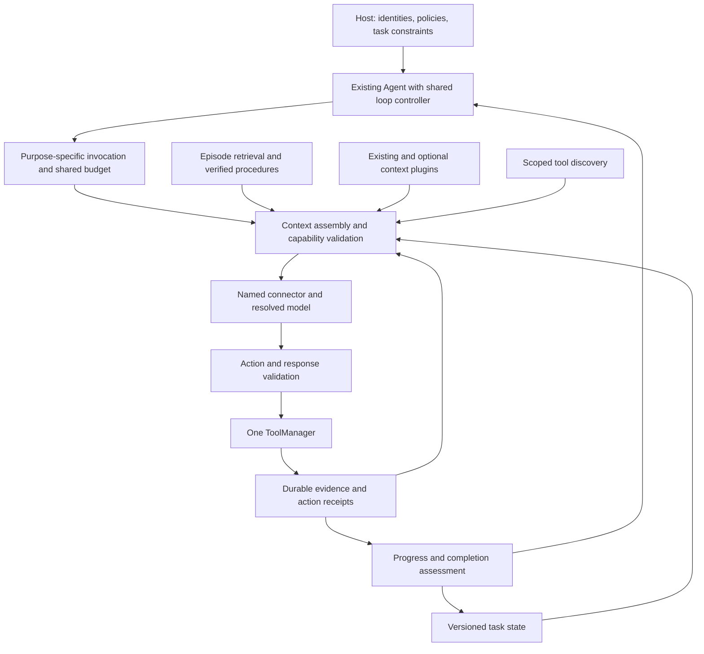

# Agentic Architecture Evolution: Staged Development Plan

- **Status:** Roadmap direction accepted; stages 00–02 and 06 complete on the development branch.
- **Stage 06 review:** All first- and second-review findings corrected and validated: 7,228 units and 48 live cases/60 scenarios pass. See the [latest completion record](STAGE_06_SECOND_REVIEW.md#correction-completion--2026-10-13).
- **Created:** 2026-10-07.
- **Revision:** 0.2; holistic review completed 2026-10-07.
- **Scope:** OneRingAI connectors, context plugins, tool execution, model invocation,
  agent control, memory, evaluation, and relevant AMOS demonstrations.
- **Working branch at plan creation:** `version2`.
- **Research cutoff:** Sources reviewed for the architecture investigation on
  2026-10-07. Provider capabilities and research results must be rechecked when
  the relevant stage begins.

This document turns the architecture review into an implementation sequence.
Delivered-stage scopes are recorded below; remaining stages describe proposed
capabilities. API names, example filenames, AMOS commands, and new module names
remain design candidates until their stage is implemented.

The outward-facing [Version 2 Guide](../VERSION_2_GUIDE.md) tracks actual capability
availability, verified adoption recipes, and handoff to the standard documentation.

## Roadmap summary

The roadmap provides a staged, additive evolution of the current library. The
recommended core sequence is **00 → 01 → 02 → 06 → 03 → 07 → 04 → 10 → 12**: small baselines,
correctness, inexpensive helper-model roles, durable observations, usable compaction,
task state, bounded feedback, and opt-in presets. IDs from the first draft are kept
stable; implementation order follows dependencies and this recommended sequence.

The other work items are **conditional extensions**, not prerequisites for core
delivery: typed context contributions/cache layouts, episodic indexes, individual
tool search, parallel tools, procedural learning, adaptive routing, delegation,
sandboxed code, native compaction, and learned retention. Select them only when a
concrete workload, measured limitation, or host integration justifies them.

Every implemented stage still requires extensive relevant tests, runnable examples,
and an AMOS demonstration where useful. No public API break or default change is
approved by this proposal. Approving the roadmap does not automatically start a
stage; implementation begins when a stage is requested.

### Changes made during the holistic review

- Removed the typed-context/retrieval/scheduling dependency chain that delayed
  helper models, summarization, and a useful product surface.
- Limited the first model-role release to a fixed main model plus explicit bounded
  helper invocations; automatic mid-trajectory provider switching is deferred.
- Separated acknowledged evidence storage from a durable effect/replay ledger, and
  distinguished existing nonblocking history logging from a persistence guarantee.
- Kept connector-origin hardening, native provider integrations, full task-DAG
  scheduling, and learned systems conditional rather than core requirements.
- Made guarantees precise: free-text constraint extraction is fallible, schema/ref
  checks do not prove summary truth, unknown prices cannot support a hard monetary
  ceiling, and receipts/idempotency cannot provide universal exactly-once execution.
- Clarified compaction ownership, one transaction per preparation, final request
  accounting, legacy hook behavior, completion-state ownership, and validation scope.
- Added live-quality requirements for model comparisons: deterministic fixtures
  verify orchestration but cannot establish that a cheaper model preserves quality.

## 1. Development agreement

1. Develop in stages. Complete the currently requested stage and its validation
   before moving to another stage. Authorization for this plan does not authorize
   implementing every stage in one run.
2. Every implementation stage includes extensive, meaningful tests, good runnable
   examples, and current public documentation. Test failure paths and compatibility,
   not just the happy path or implementation details.
3. Update AMOS when the stage introduces capabilities that users can meaningfully
   inspect or exercise. If an app change adds no useful demonstration, record that
   decision and its reason in the stage completion record.
4. Keep new APIs as backward compatible as possible. Prefer optional fields,
   additional exports, adapters, opt-in plugins, and opt-in policies. Preserve
   existing defaults, return shapes, custom plugin contracts, and saved sessions.
5. **A breaking API change requires explicit user approval.** When a concrete
   breaking change is proposed, stop that part of the work, explain the rationale,
   affected APIs and behavior, alternatives, and migration path, and wait for
   explicit approval before implementing it. A new branch, a major-version label,
   this plan, or general authorization to implement a stage is not that approval.
6. Record stage status, decisions, validation, examples, AMOS coverage, and remaining
   limitations here. Follow the persistent workflow in [AGENTS.md](../../AGENTS.md).
7. Update the outward-facing [Version 2 Guide](../VERSION_2_GUIDE.md) at every stage.
   Record verified APIs, defaults, support, adoption, examples, and limitations;
   distinguish branch availability from release. Track handoff to README, User Guide,
   generated API reference, examples, AMOS docs, specialist guides, and release notes.
   An internal-only stage still needs an explicit entry; fix affected current usage
   documentation in the delivering stage rather than waiting for a release refresh.

No breaking public API change is proposed by this plan. If source investigation
shows an additive design cannot satisfy a requirement, apply rule 5 instead of
silently turning that requirement into a migration.

At stage start, record the smallest approved scope and its acceptance criteria.
Conditional extensions listed inside a stage are not silently included. Completing
the recorded scope must not be reported as implementing its deferred extensions.

## 2. Objectives and architectural boundaries

The objective is better task completion at a measurable cost and latency, with
less forgotten state, repeated work, and incorrect tool execution. Token reduction
alone is insufficient: a smaller prompt that forces repeated searches or loses a
user constraint can make the entire trajectory worse.

Preserve the foundations already present in OneRingAI:

- Named `Connector` instances remain the source of authentication and service
  identity. Model selection never invents credentials or infers a vendor from a
  model name.
- `agent.tools === agent.context.tools` remains true. Library-executed built-ins,
  connector tools, custom tools, local MCP tools, plugin tools, and programmatic
  calls all use this manager. Provider-hosted tools and external SDK harnesses have
  their own execution boundary; do not claim local-manager guarantees for them.
- Context capabilities remain plugins. Disabled new features introduce no prompt
  blocks, tools, helper requests, or background activity attributable to that feature.
- Registries remain the source of model capabilities, limits, and supported options.
  Unknown capabilities are represented explicitly and conservatively.
- Host authorization supplies user, tenant, group, connector, and account scope.
  Models may propose actions within that scope; they cannot expand it.
- The existing memory system remains the entity/fact and long-term knowledge layer.
  Transient execution traces do not become permanent facts automatically.
- `AgentRuntime` drivers continue to represent complete agent harnesses. An external
  SDK agent is not a text provider, and cannot be assumed to expose internal model
  steps or compaction controls.

The design extends the existing architecture with durable task/evidence state,
selective context assembly, purpose-specific model invocation, and a common loop
controller. It does not create a second agent, tool, authorization, or storage
pipeline beside the existing one.

These are logical responsibilities, not a requirement for a new service or plugin
for every box. Reuse current journals, storage, domain task types, provider factories,
metrics, and hook machinery before adding abstractions. Start with the native
OneRingAI Agent; external driver enhancements are required only where a delivered
feature actually changes their shared contract.

### 2.1 Current foundations and gaps to verify

These findings are source-review observations. Stage 00 creates executable
baselines; the relevant implementation stage reproduces each concern before
changing behavior.

| Area | Existing foundation | Improvement or concern |
| --- | --- | --- |
| Context | `AgentContextNextGen`, plugin features, token accounting, snapshots | Rebuild all affected prompt components after compaction; prevent stale budget decisions |
| Compaction | Algorithmic strategy; explicit context rollover with a caller summarizer | Add automatic structured strategies without replacing the algorithmic baseline or explicit rollover |
| Working memory | Tiered scratch storage and prompt index | Separate evictable scratch from durable evidence; eviction must not silently destroy the only copy |
| Long-term memory | Entities, facts, provenance, graph/vector retrieval, permissions, ingestion | Reuse these capabilities; add session episodes and procedures without duplicating the fact system |
| Tools | Shared manager, execution plugins, permissions, output hints, execution metadata | Distinguish semantic failure from resolved promises; activate output projection; record receipts |
| Tool scheduling | Blocking execution and separate asynchronous tools | Add bounded parallel blocking execution with dependency and cancellation semantics |
| Tool discovery | Category catalog and keyword matching | Offer ranked individual discovery while retaining category APIs |
| Model invocation | Named connectors, model registry, per-call options, external usage accounting | Select provider/model before context preparation; account for every helper and recovery request |
| Agent loop | Stateful `run`/`stream`, hooks, async continuation, suspend, structured output | Extract shared decisions incrementally; add evidence-based progress and completion |
| Runtime | Local OneRingAI/Codex drivers, observable events, capability inspection | Negotiate routing/context controls per driver instead of promising unsupported step-level control |

Relevant source entry points:

- [Context manager](../../src/core/context-nextgen/AgentContextNextGen.ts),
  [plugin contracts](../../src/core/context-nextgen/types.ts), and
  [algorithmic strategy](../../src/core/context-nextgen/strategies/AlgorithmicCompactionStrategy.ts).
- [Agent](../../src/core/Agent.ts), [BaseAgent](../../src/core/BaseAgent.ts),
  [ToolManager](../../src/core/ToolManager.ts),
  [tool contracts](../../src/domain/entities/Tool.ts), and
  [result normalization](../../src/core/tool-execution/plugins/ResultNormalizerPlugin.ts).
- [Connector](../../src/core/Connector.ts), [Memory guide](../MEMORY_GUIDE.md),
  [runtime design](AGENT_RUNTIME.md), and
  [distributed execution design](DISTRIBUTED_AGENT_EXECUTION.md).

In particular, the review found prompt materialization before compaction with
partial recounting afterward, normalized tool errors potentially recorded as
success, and a hard timeout that rejects a promise without proving the underlying
action stopped. These deserve regression coverage before higher-level automation.

## 3. Target design



### 3.1 Durable state and its prompt view

Keep five distinct kinds of state with explicit ownership and lifetimes:

| State | Contents | Authority and lifetime |
| --- | --- | --- |
| Conversation | User/assistant messages, tool protocol items, provider-specific opaque state | Existing session semantics; provider state stays within its compatibility contract |
| Task state | Objectives, constraints, corrections, decisions, questions, pending/completed actions, artifacts | Host-authoritative execution facts; model semantic proposals are validated; versioned per task |
| Evidence | Full tool observations, source references, action intent/result receipts, relevant documents | Durable scoped records; raw external content retains its original trust level |
| Working memory | Scratch notes, temporary calculations, small indexes | Evictable; never implicitly the durable system of record |
| Long-term knowledge | Existing entities/facts plus verified episodic/procedural indexes | Existing ownership, provenance, permissions, freshness, deletion, and retention policies |

A prompt is a selected view of these records. Prompt omission is not deletion.
Evidence references must remain resolvable under the same trusted scope after
save/load and compaction. A missing reference produces an explicit diagnostic and
safe fallback, not an invented reconstruction.

Existing history journals already preserve full conversation records independently
of compaction, but their current writes are nonblocking. Reuse their backend/addressing
when it can provide acknowledged stable references; do not assume a fire-and-forget
append survived a crash. Store large blobs separately only where the journal or
existing artifact storage cannot provide an appropriate representation. The initial
evidence layer needs stable references and bounded reads, not a general knowledge
graph or another event-sourcing platform.

Task action statuses derive from actual execution records. Model-produced text
cannot turn a pending action into a successful write. If task state is linked to
a `MemorySystem` task entity, use its existing host-driven `transitionTaskState`
contract rather than storing a competing lifecycle in ordinary facts.

Reuse existing `Task`/`TaskStatus` and routine execution records when the host already
uses them. The plugin is a prompt view and semantic notebook over that authority;
it is not a replacement workflow engine. Only host-asserted structured constraints
can be mechanically guaranteed present. Extraction from free text is fallible;
keep source turns and distinguish proposed constraints from confirmed ones.

### 3.2 Optional typed context contributions

Introduce an additive optional contribution surface. The following is an
illustrative design sketch, not a public signature commitment:

```typescript
// Existing getInstructions()/getContent()/getTools() remain supported.
contribute({ task, phase, invocation, budget, revision, signal }): ContextBlock[]
```

Each block should identify its stable ID, source, trust/authority, token estimate,
priority, freshness, dependencies, retention requirements, and evidence references.
The central assembler handles selection and produces a manifest explaining what
was kept, projected, summarized, or omitted and why.

This contribution surface is conditional stage 05 work, not a prerequisite for
helper roles or summary strategies. Begin with a small internal block representation
and existing call/result grouping. Add general dependency metadata or a public
extension contract only after built-in and third-party use cases demonstrate need.

Legacy plugins use an adapter that preserves their current instruction/content
semantics. New typed data does not acquire instruction authority merely because
it came from a plugin. Trusted host instructions, user constraints, and untrusted
retrieved text must remain distinguishable throughout assembly.

Prompt-affecting contributions are awaited within a bounded deadline before the
request snapshot is frozen. Observational ingestion may run in the background,
but its later writes cannot retroactively alter an in-flight request. Every
mutation invalidates the relevant token and layout caches.

The existing `onBeforePrepare` observational hook retains its nonblocking behavior;
do not silently await it or change its failure semantics. Awaited contributions use
a distinct optional contract. Legacy plugins still contribute exactly as before.

### 3.3 Context planning and compaction transactions

For the new structured strategies, use a snapshot/plan/validate/apply sequence under
a revision boundary. A compaction
plan describes changes; the context validates protocol dependencies, protected
state, source references, and token savings before atomically applying them.
If the revision changed, discard or recompute the plan. Never overwrite newly
arrived input, user corrections, async tool results, or provider state.

Keep one bounded compaction transaction per preparation. Recount and validate its
result before dispatch; if it cannot fit, return a clear limit/fallback outcome
instead of repeatedly invoking summarizers. Preserve existing custom strategy
contracts through the legacy path, with documented limits on rollback of plugin
side effects. Do not promise multi-store atomicity from an in-memory revision check.

Compaction preserves connected tool-call/result components and required provider
protocol items. Protect active work, unresolved action outcomes, critical IDs and
arguments, and fresh observations until they have had a useful consumption
opportunity. If protected content alone exceeds the model limit, return an explicit
limit condition or a valid projection policy rather than silently dropping it.

Retain the algorithmic strategy as the inexpensive baseline. Add observation
masking and structured summaries as separately configurable strategies. Explicit
rollover remains supported; it must not race automatic compaction. Provider-owned
compaction is another capability-gated ownership mode, not an additional compactor
running against the same state.

### 3.4 Purpose-specific model invocation and budgets

Resolve an invocation profile for a purpose, then prepare context for that profile.
A profile binds a host-approved connector, model, supported reasoning/options,
required capabilities, and data-handling policy. Do not change a global agent model
mid-request or rely on an after-prepare hook to make the context fit a new model.

Start with `main` and `compaction` roles; add another helper only when an actual
stage needs it. The purposes below are an extension map, not six compulsory agents
or six calls per turn. Resolve helper input limits before building a bounded packet;
never copy provider-opaque reasoning items into a different model's prompt.

| Purpose | Initial policy | Important constraint |
| --- | --- | --- |
| Main reasoning/action choice | Current agent model | Strong model where task difficulty warrants it |
| Bounded extraction/classification | Optional inexpensive structured-output model | Small scoped packet, schema validation, explicit uncertainty |
| Compaction | Configured evaluated model; may be inexpensive or stronger | Fidelity matters more than nominal per-token price |
| Formatting/repair | Deterministic validation first; bounded helper if needed | No tool access unless explicitly required and authorized |
| Verification | Deterministic predicate first; optional independent model | A judge opinion is not proof that an external action succeeded |
| Recovery | Bounded escalation on observed failure/no progress | Typed reasons, budget checks, and no repeated unsafe actions |

Existing calls use the current model unless a new policy is explicitly enabled.
Enabling a role does not mandate that it runs on every turn. Helper requests are
tool-free by default and receive only the evidence they need.

The shared budget tracks all main, helper, retry, repair, compaction, embedding,
verification, and delegated requests attributable to the task. Distinguish uncached
input, cache reads/writes, output, and reasoning usage according to each provider;
do not double-count reasoning already included in billed output. Unknown pricing
or usage is unknown, never zero. Reserve capacity before concurrent dispatch and
reconcile actual usage afterward. Enforce call, token, cost, and deadline limits
with a documented policy for incomplete provider accounting.

For a strict monetary ceiling, reject dispatch when a reliable conservative price
bound is unavailable, or require an explicit host policy using bounded call/token
limits instead. Do not promise a hard billed-cost ceiling from unknown prices.
Late usage and cancelled/background helpers remain attributed to the original task.

Count a nested invocation once in the task total while allowing parent/child
breakdowns. Independently scheduled memory ingestion uses its own explicit budget;
it must not spend an expired task's reservation. Unless an integration supplies
prices, external tool fees and infrastructure cost are excluded from model-cost
totals and labeled separately. A single-process shared budget is sufficient first;
distributed reservation coordination is outside core scope.

The first release keeps the main connector/model fixed and configures separate
compaction/extraction helpers. It does not require migrating an active conversation
between providers. Automatic main-model switching and generalized portable capsules
belong to conditional stage 14; unsupported state transfer is rejected until then.
Models with incompatible opaque state require an explicit supported session boundary
or a later portable task/evidence capsule. No cross-provider transport of signed,
encrypted, or otherwise provider-owned state is assumed. External harness drivers
advertise which controls they actually support, including per-run versus per-step
routing.

### 3.5 Tool outcomes, execution, and discovery

Add internal canonical outcomes and optional public metadata while preserving raw
legacy return values. A proposed envelope contains semantic status, structured
error, data/projection, artifact references, provenance, and an execution receipt.
Application code can still access the complete result. `ToolOutputHints` participate
in managed projection; they must not erase arguments, identifiers, or action status.

Separate effect classification, cacheability, and idempotency. A read can be stale
and unsuitable for caching; a write can be idempotent only with a supported key or
other verified contract. Maintain an action ledger for resumption and ambiguous
network outcomes only when conditional stage 11 delivers resumable effects; the
core evidence layer records observations and outcome references without becoming
a write-ahead workflow ledger. A timeout does not imply that an action was cancelled. Record
`outcomeUnknown` when termination or external commit cannot be established, and
reconcile before considering a retry.

An HTTP acknowledgement can confirm that a service accepted a request without
proving the requested workflow finished. A timeout of a known local pure read is
different from an uncertain external write. Classify those cases using declared
effects and available receipts; do not mark every timeout as an unknown write.
Late results stay bound to their original execution and identity, and reconcile
an uncertain record through a versioned update rather than creating a second action.

Parallel blocking calls initially use an explicitly independent batch and conservative
read-only allowlist, resource/account concurrency limits, stable result correlation, and common
authorization. Existing asynchronous-tool continuation remains a distinct feature.
Ranked individual discovery exposes only tools available within host scope; loading
or discovering a tool never authorizes an action.

Programmatic tool calling is an optional later capability. Code receives constrained
tool proxies that call the same manager, not credentials or unrestricted connector
objects. Enforce resource limits, cancellation, permission/effect checks, and
bounded outputs before exposing this surface.

### 3.6 A shared feedback-driven controller

The intended control sequence is:

1. Incorporate new observations and host-authoritative state.
2. Assess task phase, progress, pending effects, and available budget.
3. Resolve model/options, then assemble scoped context and tools.
4. Invoke the named connector and validate the response/actions.
5. Execute through the existing manager and persist outcomes/receipts.
6. Apply validated task-state deltas and completion predicates.
7. Continue, recover, suspend, request needed input, or finish with an explicit status.

Extract this controller incrementally from `run` and `stream`, using shared decisions
and an effect/event boundary while keeping their output contracts. Planning and
reflection are optional at useful phase boundaries. Do not add a mandatory planner
or critic request to every iteration. Share a few internal decision/preparation
helpers first; a full new state-machine framework or effect interpreter is not
required. Extract further only when parity tests and concrete duplication justify it.

Completion requires configured evidence, tests, receipts, or host predicates when
the task defines them. Assistant prose alone does not satisfy a write or workflow
completion predicate. Detect repeated normalized calls, unchanged observations,
and lack of task progress; recovery is bounded and responds to typed causes.

Preserve existing task/routine lifecycle enums and use optional diagnostics for
turn completion, pending input, or uncertain action issues. Ordinary chat can finish
with an answer; a workflow with an explicit completion predicate cannot claim that
predicate passed solely because a turn ended. Keep tool outcome, turn completion,
and host task status distinct without defining competing public state machines.

### 3.7 Cache-aware assembly and model profiles

Keep stable instruction/schema prefixes separate from dynamic task data, current
time, retrieval, and selected evidence. Use deterministic tool ordering and schema
versioning. Choose provider-supported layouts that preserve message authority;
cache efficiency never justifies reclassifying retrieved text as developer rules.
Native tool-discovery/cache layouts are optional adapters, not a mandatory new
prompt serializer for every provider. A host cache key is not itself an access-control
guarantee; enforce trusted scope before selecting content and follow provider cache
isolation/retention semantics.

Measure effective billed cost and latency using actual cache metrics. A slightly
larger cacheable prompt may be cheaper than a frequently rewritten smaller prompt.
Cache keys and telemetry must respect tenant, connector/account, model, instructions,
and schema scope. Do not label local token-estimator caches as provider prompt caches.

Later opt-in chat, research, coding, and workflow presets bundle validated policies.
Provider/model harness profiles adapt supported reasoning, caching, tool discovery,
and context behavior. Explicit user settings override presets; capability conflicts
fail preflight or use a documented safe fallback.

## 4. Stage sequence and tracking

Stages 00–02 and 06 are complete on the `version2` branch. Stage 06 is validated
in the working tree based on committed Stage 02 revision `dcc8dad`; provider and
validation limits are recorded below.
Dependencies determine readiness, not authorization. IDs are stable identifiers;
the core sequence is **00 → 01 → 02 → 06 → 03 → 07 → 04 → 10 → 12**. Later stages
remain separately authorized work.

| Stage | Deliverable | Dependencies | Track | Status |
| --- | --- | --- | --- | --- |
| 00 | Small compatibility/trajectory baselines and existing-metric reporting | None | Core | Complete |
| 01 | Fresh final request accounting and protocol-safe compaction | 00 | Core | Complete on branch |
| 02 | Accurate tool outcomes and per-execution cancellation | 00 | Core | Complete on branch; final local and full OpenAI/Anthropic/Google live validation passed |
| 03 | Acknowledged evidence references, projections, and outcome records | 01, 02 | Core | Not started |
| 04 | Task-state prompt view and protected host constraints | 03, 06 | Core | Not started |
| 05 | Typed contributions and selective/cache-aware assembly | 01, 03, 04 | Conditional | Not started |
| 06 | Fixed main model, bounded helper roles, and task usage/budgets | 01, 02 | Core | Complete on branch; first- and second-review corrections validated, all local/live gates pass |
| 07 | Structured summaries and observation masking | 03, 06 | Core | Not started |
| 08 | Episodic retrieval and session ingestion | 03, 04, 06 | Conditional | Not started |
| 09 | Ranked individual tool discovery | 01, 02 | Conditional | Not started |
| 10 | Shared decision helpers, bounded recovery, and completion predicates | 02, 03, 04, 06 | Core | Not started |
| 11 | Optional parallel reads and separately scoped resumable effects | 02, 03, 06 | Conditional | Not started |
| 12 | Minimal opt-in presets and capability inspection | 04, 06, 07, 10 | Core | Not started |
| 13 | Verified procedural memory and curated learning | 08, 10 | Conditional | Not started |
| 14 | Adaptive routing and separately scoped specialist delegation | 06, 10 | Conditional | Not started |
| 15 | Sandboxed programmatic tools and bounded recursive inspection | 03, 06 | Conditional | Not started |
| 16 | Native compaction adapters and separately scoped retention experiments | 00, 06, 07 | Conditional | Not started |

**Recommended core delivery order:** 00 → 01 → 02 → 06 → 03 → 07 → 04 → 10 → 12.
Stage 04 can follow stage 03 before stage 07 if the first host workload needs task
state immediately. No core stage requires a conditional stage.

Milestones and stop points:

- **Correctness:** 00, 01, 02. Ship fixes without waiting for new context APIs.
- **First model/context value:** add 06, 03, 07. The same main model can use an
  inexpensive evaluated compactor, masking, and durable source references.
- **Core product surface:** add 04, 10, 12. Task state, bounded feedback, and
  useful opt-in presets are illustrated in AMOS. The core roadmap is complete here.
- **Workload-driven efficiency:** choose 05, 08, 09, or 11 independently when
  context layout, earlier-session recall, tool catalogs, or tool latency is a problem.
- **Measured learning/cooperation:** choose 13 or 14 after reliable outcome labels
  exist. Routing does not require first building a procedural-memory system.
- **Provider integrations/research:** choose 15 or 16 only for a specific use case.
  Native compaction is a provider-contract integration; learned retention is an
  experiment. Neither blocks the core roadmap.

### Stage 00 — Baselines, evaluation, and compatibility inventory

**Goal:** Make subsequent quality, compatibility, cost, and latency claims testable.

**Work:** Inventory public exports, plugin/strategy extension interfaces, documented
defaults, tool return values, and lifecycle behavior that the first core changes
touch. Preserve representative consumer compile fixtures and old saved sessions.
Build a small test reporter over existing events/usage, with run/step/parent IDs,
connector/model, outcomes, and unknown usage fields. Start with four deterministic
fixtures: ordinary chat, large tool observations, research/source retention, and a
mock external workflow with cancellation/resumption. Add coding and broader runtime
coverage when their contracts change. Define held-out splits and a live-evaluation
recipe without building a general benchmark platform or freezing every public API.

**Required tests:** Fixture determinism; redaction of auth and confidential payloads;
legacy public import/type compatibility; valid and malformed session restoration;
usage accounting with missing fields; event correlation; cancellation in the evaluator;
evaluation predicates that reject plausible prose without task completion. Include
branch-aware simulations: replaying a recorded future result for different arguments
is forbidden unless the fixture explicitly models that counterfactual.

**Examples:** A proposed `agentic-evaluation-baseline.ts` runs a small offline task
suite and reports completion, calls, usage availability, and repeated work. Document
how to add a fixture and how a live run differs from replay.

**AMOS:** Record current commands/output as the app baseline. No app changes are
required for test-only fixtures; add visible reporting when stages 01/02/06 deliver
new information. This is an explicit not-applicable decision, not missing stage work.

**Compatibility:** Baseline collection and evaluation are opt-in. Existing logging,
responses, and event consumption do not require the new trajectory format.

**Exit gate:** Reproducible baseline reports and consumer compatibility fixtures;
recorded per-workload quality gates and statistical protocol. No routing or context
default changes. Stochastic evaluation records model version, seed where supported,
sample count, and uncertainty.

### Stage 01 — Context freshness and compaction invariants

**Goal:** Every model request reflects the context revision actually selected for it.

**Work:** Reproduce stale prompt/token issues around `prepare()` and compaction.
Rebuild affected plugin content, tool definitions, instructions, history, and token
counts after mutation and final protocol sanitation. Give strategies the current
budget, not a prior prepare's cached value. Validate protocol groups using the
actual provider item contract: multiple calls in one message are different from
multiple final results for one call. Keep one bounded compaction transaction;
recount afterward and fail clearly if the request still cannot fit. Preserve
rollover revision safeguards and configured oversized-input behavior.

**Required tests:** Fresh working-memory index after eviction; changed catalog
definitions and recounted schema tokens; correct first-call budget; repeated prepares;
valid current input not silently compacted; explicit oversized-input policy unchanged;
multiple calls per message; permitted result-update patterns; missing/orphaned items;
image/multimodal accounting; interleaved async results; rollover race; stale strategy
proposal; protected content larger than the window; disabled plugins absent;
budget matches the actual sanitized request; observational hooks run only as before;
no compaction or critical-threshold changes below the existing trigger.
Add regression cases for both managed `run()` and `stream()`.

**Examples:** `context-compaction-freshness.ts` forces a small mock window and shows
the prepared view before/after compaction, retained dependencies, and final budget.

**AMOS:** Make `/context budget` and `/context breakdown` reflect the last prepared
revision and explain when a displayed budget is only an estimate. Cover commands
with unit tests and a recorded offline demonstration.

**Compatibility:** Keep current strategies, configuration, plugin contracts, and
defaults. If a stricter rule rejects a previously documented valid extension, stop
and apply the breaking-change approval rule before making it mandatory.

**Exit gate:** Regression fixtures pass with no stale components or dangling protocol
items, legacy strategies still run, and context convergence has a finite bound.

### Stage 02 — Tool outcomes and per-execution cancellation

**Goal:** Failure and timeout reporting match what execution can actually establish.

**Work:** Add internal semantic outcome classification to the existing pipeline.
Recognize failures emitted by the library's normalizer without assuming every
application object containing `success: false` uses that contract. Keep legacy raw
returns; add inspectable outcome metadata. Use pipeline-owned markers rather than
guessing a failure from arbitrary returned data. Compose host/tool/deadline signals
per execution without mutating the shared tool context. Distinguish cancellation
requested/confirmed, late completion, and effect-specific unknown outcome. Ensure
late results cannot contaminate another run/account. Do not change retry or breaker
policy incidentally while correcting diagnostics. Connector-origin/redirect hardening
is a separately requested conditional extension after core delivery.

**Required tests:** Thrown versus normalized failures; successful domain data with
a false-valued field; metrics and failure counters; permission denials; timeout of
a cooperative tool; a tool ignoring abort; late completion after timeout; correct
original-call correlation and no double metric accounting; composed signal cleanup;
host abort plus connector timeout; OAuth/account binding; new opt-in recovery policy
does not retry ambiguous writes; cancellation during response-body reads, streaming,
and retry backoff where those paths are supported. Use local mocked HTTP fixtures,
no credentials. Document header-only versus whole-operation timeout semantics.

**Examples:** `tool-outcomes-and-cancellation.ts` demonstrates cooperative and
noncooperative tools plus a loopback connector request with composed cancellation.
A future origin-policy extension adds its own example and redirect/origin tests.

**AMOS:** Display semantic failure and uncertain completion accurately. A cancelled
UI run must not claim that an external write was prevented. Add rendering and
abort-path tests to `AgentRunner` coverage.

**Compatibility:** Existing tool implementations need not accept a new mandatory
parameter. Existing documented retries/breaker rules and error/return shapes remain
supported; assess any intended behavior correction against its public contract.
Future origin restrictions are opt-in; rejecting supported legacy URL behavior or
changing defaults requires the breaking-change procedure if incompatible.

**Exit gate:** Accurate diagnostics and signal lifecycle, unchanged legacy result
contracts, and no new automatic retry path for uncertain effects. Cancellation is
reported according to what the tool/connector can actually establish.

### Stage 03 — Durable evidence and projected tool outputs

**Goal:** Context reduction never loses the only copy of an important observation.

**Work:** Add a minimal evidence capability through `StorageRegistry`, with scoped
in-memory/file support by reusing existing journal/artifact backends where possible.
Add only missing capabilities: acknowledged stable references, bounded reads,
ownership, schema versions, integrity, and retention. Persist observations before
projecting away their raw prompt content. Use output hints in opt-in middleware;
keep raw application returns. Record outcome refs with call ID, relevant arguments,
trusted identity, timestamps, and effect classification. Do not build action-intent,
replay, or distributed-transaction machinery here; stage 11 owns that conditional
scope. Expose whether the configured store is process-local or restart-durable.
Document the acknowledgement strength: ordinary process restart, fsync-backed crash
durability, and distributed durability are different contracts. Do not infer the
strongest one from an awaited append alone.

**Required tests:** Large output projection preserves status/IDs; raw result access;
legacy return compatibility; serializability failures; storage write failure before
projection; result-store failure after a real effect; restart after acknowledged writes;
scope isolation; reference integrity; missing/corrupt blobs; retention and deletion;
scratch eviction leaves evidence intact; cancellation/unknown outcomes; snapshot
restore references; bounded blob/index size; read backpressure; failed/throwing
projection cannot reclassify a successful tool effect as failed. Framework credentials
never enter evidence/logs; sensitive source content follows host storage/redaction policy.

**Examples:** `durable-tool-evidence.ts` uses a mock large search result, projects a
small view, evicts scratch, and retrieves exact data after restarting. A separate
fixture shows a write with an ambiguous response and its unresolved receipt.

**AMOS:** Add evidence inspection through `/context` or a focused command, with
bounded previews and reference lookup. Avoid printing complete sensitive blobs by
default. Show persistence failure and unresolved action receipts in the run view.

**Compatibility:** Evidence and envelopes are opt-in; raw custom-tool outputs and
existing context saves stay valid. Add versioned snapshot fields rather than
replacing the current persistence contract.

**Exit gate:** Acknowledged file-backed refs survive compaction/restart, while an
in-memory adapter promises only its process lifetime. On storage/projection failure,
retain raw content or stop context dispatch explicitly; never repeat the action to
recreate a result. Evidence-write failure and tool-effect outcome stay distinguishable.

### Stage 04 — Task-state plugin

**Goal:** Goals and user constraints survive long executions independently of prose.

**Work:** Add an opt-in task-state plugin with objectives, constraint/correction
records, decisions with evidence, open questions, artifacts, and action references.
Separate observed facts, host assertions, model proposals, and assumptions. Validate
semantic deltas against a revision; host execution events alone establish action
status where execution proves it; externally accepted/pending actions remain pending
until their configured completion condition holds. Protect host-confirmed constraints
and pending/unknown actions from compaction. Reuse existing task/routine status types.
Define task/session association, resumable snapshots, and the optional connection to
existing memory task entities. Start with host APIs and deterministic state updates;
bounded LLM extraction uses stage 06 only when explicitly configured. Do not promise
automatic flawless extraction of every constraint from ordinary conversation.

**Required tests:** User correction supersedes a prior constraint; conflicting
constraints remain explicit; forged tool instructions cannot change task authority;
model cannot mark a write done; acknowledgement differs from completed workflow;
unconfirmed extracted constraints retain source/uncertainty; concurrent revision conflicts; pending action after
restart; task switch isolation; host memory lifecycle integration; schema upgrades;
disabled plugin contributes no content/tools; legacy agent behavior unchanged.

**Examples:** `task-state-workflow.ts` walks a simulated task through constraint
changes, action evidence, suspension, and resumption, showing the validated state.

**AMOS:** Show objectives, active constraints, pending/completed actions, questions,
and unresolved outcomes. Any edit command uses host validation and is tested for
revision conflicts; model text does not become an AMOS control command.

**Compatibility:** Task state is an additional optional plugin; existing in-context
memory and working-memory tools remain available and keep their contracts. Older
sessions do not need task records to load or run.

**Exit gate:** Long-session fixtures retain confirmed hard constraints and known
action outcomes; extraction errors are measured separately. Existing task/routine
and memory lifecycle authority is preserved. This prompt view does not itself
guarantee duplicate-effect prevention; optional stage 11 provides applicable mechanisms.

### Stage 05 — Context blocks, selection, and cache-aware layout

**Goal:** Context selection is budgeted, attributable, and explainable.

**Work:** First demonstrate that existing plugin views cannot meet a measured
selection/cache need. Then add small optional typed contributors and the legacy adapter. Implement a central
assembler with component budgets, dependency closure, protected blocks, freshness,
trust-aware placement, and a selection manifest. Add model/provider-aware estimates
for tools, messages, and multimodal data with configurable output/reasoning reserve
and actual-usage calibration. Provide an opt-in stable-prefix layout with deterministic
tool ordering and late dynamic content where provider semantics allow it. Capture
actual provider cache usage separately from local caches.

**Required tests:** Unmodified third-party plugin works; optional methods absent;
preexisting similarly named helper method is not accidentally treated as a contributor;
dependency cycles and unavailable refs; protected blocks; deadline/failed contributor;
stale revisions; hostile retrieved instructions stay data; schema size accounting;
unknown model limits; output reserve; multimodal/provider opaque items; deterministic
prefixes; dynamic date/state changes; cache key isolation; usage-estimate divergence;
all new features disabled reproduces the legacy surface.

**Examples:** `context-block-selection.ts` compares legacy and typed plugins and
prints a manifest. `cache-aware-context.ts` illustrates layout deterministically;
an optional live mode reports observed cache behavior without promising a hit.

**AMOS:** Extend `/context breakdown` with selected/omitted/projected blocks and
reasons. Distinguish provider prompt caching from working-memory/index caches.
Test empty, partial, and unknown metric displays.

**Compatibility:** Typed methods are optional; custom plugin implementations and
current layout continue to work. New layout is opt-in until evaluated. Changing
documented prompt authority or mandatory plugin signatures requires approval.
Prefer a companion contributor registration/adapter if extending the original
structural interface would conflict with existing plugin implementations.

**Exit gate:** Valid fitting views and truthful manifests across fixtures; protected
constraints remain present; cache/cost accounting has explicit unknown values.

### Stage 06 — Purpose-specific invocation and shared budgets

**Goal:** Use different models deliberately without losing control of state or cost.

**Work:** Add optional static helper-role configuration through existing connector/
provider factories, starting with the current main model and a configurable compactor.
Resolve helper model/options/input limit before constructing its packet; validate
capabilities and data-handling scope. Add a thin common accounting/budget boundary,
not a model marketplace or separate agent framework. Enforce request/output/token/
deadline limits and cost ceilings only with a reliable price bound; reuse actual
usage. Define in-process reservations that later parallel calls/workers can reuse,
but defer distributed budgets and native-state migration. Bind helpers to a purpose,
parent invocation, cancellation, and bounded output schema; helpers have no tools.

**Required tests:** Legacy single-model calls; roles disabled make no extra requests;
inexpensive helper and stronger main with different windows; unsupported effort or
structured output; unknown prices; cache/reasoning accounting without double count;
provider retry and repair usage; single-process concurrent reservation races; timeout and cancellation;
helper malformed JSON and escalation; native-state incompatibility; unapproved
connector/account selection; cleanup; unchanged main-provider state; no cross-provider
opaque items in helper packets; externally supplied usage is attributed once.

**Examples:** `purpose-specific-models.ts` runs an offline extract/main/verify scenario
with mock models and includes an explicit live configuration recipe. `shared-run-budget.ts`
demonstrates reservations, exhaustion, and unknown pricing behavior.

**AMOS:** Add role/profile configuration and a purpose-attributed usage view with
connector/model/reasoning selection. Show the expected extra requests before users
enable a policy; preserve existing single-model configuration and session loading.

**Compatibility:** Existing `Agent.create`, `run`, `stream`, and direct-call signatures
and defaults remain. Profiles add optional configuration. Never serialize credentials
or runtime authorization as portable agent package data.

**Exit gate:** Every dispatched model attempt is tracked, with unknown actual usage
explicitly represented; no unsupported state transfer. Demonstrate main+helper use
without new context-plugin infrastructure. Cheap-model quality claims require the
bounded live comparison introduced by stage 07, not scripted mock answers.

### Stage 07 — Structured summaries and observation masking

**Goal:** Offer useful out-of-box alternatives to algorithmic compaction.

**Work:** Extend the strategy registry additively with observation masking and a
structured-summary strategy using existing context snapshots/rollover concepts;
explicit rollover remains restricted to its supported between-executions boundary.
Automatic compaction uses a dedicated safe pre-call integration, not an illegal
mid-run `rolloverContext()` call. It does not depend on typed contributions or the
task-state plugin. Summary schema covers completed work, active work,
constraints, decisions, uncertainties, artifacts, action receipts, and source refs.
Use source-backed bounded summaries, retaining raw source refs and important
verbatim host constraints/IDs. Validate schemas, refs, dependencies, and revisions;
those checks cannot prove all semantic statements true. Budget helpers through
stage 06 and preserve fresh dependencies. If a helper fails, use one documented
fallback within the same transaction or fail clearly; never send an oversized
request after a no-op fallback. Keep summary data from acquiring host-rule authority.

**Required tests:** Exact parameters/receipts survive; constraints and corrections;
summary hallucination/missing refs; schema repair bounds; oversize/empty summaries;
no real token savings; stale snapshot; concurrent user input/async completion;
repeated summary generations; pending effects; multimodal/opaque state; persistence;
one compaction owner; helper budget exhausted; explicit rollover compatibility.

**Examples:** `context-strategy-comparison.ts` compares algorithmic, masking, and
structured summaries on the same simulated long task, including helper cost and
reacquisition calls. Clearly separate deterministic correctness from live quality.
Add a bounded opt-in live comparison of at least the intended main/helper combination
on held-out long-task cases before claiming the inexpensive compactor preserves quality.

**AMOS:** Permit explicit strategy selection and report trigger, savings, helper
usage, fallback, and preserved refs. Explain the tradeoff without recommending the
cheapest nominal model before its fidelity has been evaluated.

**Compatibility:** New strategy registrations are opt-in. Existing strategy APIs,
the explicit rollover callback contract, and the algorithmic default remain valid;
no helper model or new storage backend becomes mandatory for existing agents.

**Exit gate:** Protocol/state invariants pass; held-out comparisons meet the stage 00
quality gate. Algorithmic remains the default and reference baseline; changing that
default is a separate compatibility/product decision, not an automatic stage outcome.

### Stage 08 — Episodic retrieval and ingestion

**Goal:** Recover relevant earlier work without reinjecting entire sessions.

**Work:** Build a scoped episode index over the existing history journal, evidence,
and task-state revisions. Store bounded action/decision summaries with exact source
references, task/entity tags, timestamps, versions, and outcomes. Use lexical
retrieval first and optional existing embedding/ranking facilities where useful.
Implement bounded journal/source lookup before adding a maintained episode index;
an index is justified only when lookup latency/relevance on real sessions requires it.
Add an opt-in retrieval plugin with bounded preparation latency and asynchronous
indexing that respects revisions. Reuse existing session ingestion and memory
permissions; do not convert every tool output into a permanent fact.

**Required tests:** Earlier decision recovered after compaction/restart; lexical
fallback after embedding failure; wrong account/tenant denied; deleted source and
tombstones; superseded facts and freshness; revoked access; untrusted instruction
payloads; duplicate ingestion; index lag; no network on disabled plugin; retrieval
budget/deadline; task switch; bounded retrieval output; source ref resolution.

**Examples:** `episodic-context-retrieval.ts` spans two simulated sessions and recovers
a prior verified result while excluding stale and unauthorized records. Explain
the distinction between an episode, scratch note, fact, and source document.

**AMOS:** Inspect retrieved episodes, why they matched, scope/freshness, and source
refs; provide host-authorized deletion/forgetting through existing appropriate APIs.
Display retrieval cost and evidence cache hits only where actually measured.

**Compatibility:** Existing memory plugins/tools and visibility behavior stay intact;
new production presets require explicit safe ownership/scope. Do not change legacy
memory visibility defaults as an incidental part of this stage.

**Exit gate:** Multi-session task fixtures improve continuity without violating
permissions or increasing hidden ingestion cost; report reacquisition and task success.

### Stage 09 — Ranked individual tool discovery

**Goal:** Select a useful small tool surface without loading entire categories.

**Work:** Add individual search/load APIs beside existing category discovery. Rank
names, aliases, descriptions, schemas, examples, and capability tags using a lexical
baseline and optional semantic reranking. Apply connector/account/category scope
before returning metadata. Support pinned tools, a token/definition budget, stable
selection, and model/provider-native deferred discovery when supported. Maintain
the one manager and validate tool-name collisions and stale catalog versions.

Start with lexical ranking through the current catalog. Semantic reranking and native
deferred discovery are separately requested extensions. Native discovery of local
functions still leaves execution in `ToolManager`; provider-hosted MCP execution
has a different policy boundary and is not implicitly included in this feature.

**Required tests:** Relevant top-k results among large synthetic catalogs; rare
exact name/parameter matches; aliases; pinned tools; token limits; deterministic
ranking; stale/unloaded definitions; category API compatibility; scope leakage;
discovery cannot bypass permission policy; connector account binding; MCP reconnect;
schema changes; native search unsupported fallback; no unrequested semantic calls.

**Examples:** `individual-tool-discovery.ts` searches a synthetic large catalog and
compares full/category/individual definition cost with identical actions. Include
a provider-native deferred-discovery recipe only for advertised capabilities.

**AMOS:** Extend tool inspection to search individual tools and show loaded/pinned
definitions, estimated schema tokens, and selection reasons. Explicitly distinguish
visibility, loaded state, and action permission in output and tests.

**Compatibility:** Keep category load/unload, existing names, registry behavior, and
current permission evaluation order. New metadata and individual APIs are additive.

**Exit gate:** Catalog fixtures select the required tools within budget without
scope leaks; quality and reacquisition are measured, not inferred from fewer schemas.

### Stage 10 — Shared controller, progress, and completion

**Goal:** Managed run and stream share execution decisions and finish truthfully.

**Work:** Share focused request-preparation, response-classification, and continuation
decision helpers in the existing loop. Do not require a complete controller rewrite. Preserve
effect execution in the existing manager and the established event transport.
Add optional progress policies and completion predicates tied to evidence/state.
Detect repeated normalized calls/results, unchanged state, and typed failures;
use a bounded retry/input-needed policy first. Retrieval/escalation are optional
only when their features and budgets are configured. Reuse existing task/routine
statuses; add optional diagnostics for turn completion, unmet predicates, and
uncertain effects without changing `response.output_text` or stream discriminants.

**Required tests:** Equivalent run/stream action traces; hook order; streamed partial
output and refusal; empty-response retry; structured-output repair; suspend/resume;
async tool results while a turn runs; execution leases; cancellation at every effect
boundary; observer disconnect does not stop runtime work; explicit predicates reject
premature final prose; repeated-call detection permits legitimate repeated reads;
recovery budgets; no duplicate tool execution; old event consumers continue compiling.
Include realtime/external-tool bridge regression tests wherever shared code is used.

**Examples:** `feedback-driven-agent.ts` shows a mock transient failure, bounded
recovery, and an evidence-based completion check. `run-stream-equivalence.ts` shows
the same task through both managed APIs and compares semantic outcomes.

**AMOS:** Display phase, progress reason, recovery, and completion status separately
from assistant output. Present an input-needed state without inventing an approval
request. Test resumed and cancelled sessions through the app's adapter.

**Compatibility:** Do not rename/remove current events or statuses. Add optional
status metadata and opt-in stricter completion policies. An exhaustive-union change
or altered documented default stopping behavior requires the approval process.
Preserve ownership of realtime and external SDK loops rather than forcing them
through a controller that cannot actually control their internal steps.
Preserve intentional API differences, including nonstream-only structured-output
repair where documented; parity tests compare shared decisions under equivalent
capabilities rather than adding unsupported streaming behavior.

**Exit gate:** Legacy decision/hook trace parity under equivalent mock inputs and
lifecycle regressions pass before enabling policies. Streaming chunks need not
match nonstream output byte-for-byte. New configured completion predicates cannot
claim unresolved effects succeeded; ordinary chat has no mandatory workflow verifier.

### Stage 11 — Bounded parallel blocking tools and safe resumption

**Goal:** Reduce independent-tool latency while preserving execution safety.

**Work:** First add optional independent read-only batches using the current executor,
conservative effect defaults, resource/account concurrency keys, per-batch limits, stable result
correlation, and common deadline/budget enforcement. Each call still passes through
manager hooks, permissions, normalization, evidence, and receipts. Add optional
idempotency keys and resumption middleware using the action ledger. Preserve existing
cacheability/idempotency fields; document their distinctions and conservative mapping.
Unknown effects serialize by default under the new scheduler. Reconcile uncertain
actions before replaying them; never claim universal exactly-once execution.

Parallel reads and resumable effects are two independently selected scopes. A
parallel-read request does not imply building write-ahead logging or replay. Add a
dependency DAG only for a demonstrated workflow requirement, reusing existing task
dependencies where appropriate. The resumable-effects scope requires acknowledged
intent-before-dispatch, result persistence, explicit crash windows, provider-supported
idempotency/reconciliation, and a host policy for irreconcilable outcomes. A late
result updates its original receipt; it does not create another dispatch.

**Required tests:** Independent reads overlap under fake clocks; dependencies and
same-resource writes serialize; mixed success/failure; partial batch cancellation;
queued call cancelled before dispatch; noncooperative timeout; deterministic call/result
association; permission prompt sequencing; hook parity; account concurrency isolation;
crash/restart at each receipt boundary; duplicate provider idempotency key; stale cache;
unknown write cannot retry automatically; async continuation remains unchanged.

**Examples:** `parallel-blocking-tools.ts` compares serial and bounded mock reads,
then demonstrates ordered writes. `resumable-actions.ts` simulates restart and an
ambiguous external response, including provider-supported reconciliation.

**AMOS:** Show queued/running/completed calls and unresolved actions; permit supported
cancellation without asserting all external effects stopped. Test rendering stable
result order when completion order differs.

**Compatibility:** Existing sequential execution remains default; asynchronous tools
keep their current API. Do not reinterpret deprecated idempotency fields in a way
that silently changes existing applications. Scheduler and receipt-based replay
are opt-in until their contracts are proven.

**Exit gate:** Measured latency benefit for independent work with no duplicate effects,
permission bypass, or lost results; crash fixtures require explicit reconciliation.

### Stage 12 — Minimal presets and capability inspection

**Goal:** Make the earlier capabilities usable without extensive application wiring.

**Work:** Ship two useful opt-in compositions first: a long-running assistant/research
preset and an evidence-aware workflow preset. The current plain Agent remains the
chat baseline. Add a coding preset only after real coding fixtures justify different
settings. Presets are small config factories over delivered plugins/policies, with
explicit overrides and resolved-capability inspection; do not create another provider
profile registry duplicating model metadata. Additional profiles/cache layouts are
conditional follow-ups. Reject unavailable features rather than silently depending
on stages 05/08/09/11. Portable package/runtime changes are needed only when these
new settings cross their existing public boundaries. Native compaction is stage 16.

**Required tests:** Existing agent configuration unchanged; preset override precedence;
disabled feature zero contributions/calls; unknown and unsupported profile settings;
model registry consistency; provider-local state cannot cross compatibility boundaries;
no native-compaction/tool-search claims for unsupported drivers; external driver
capability limits; applicable portable config
rehydration under a new host scope; upgrades from old AMOS settings and snapshots.

**Examples:** `agentic-presets.ts` shows both initial presets and the unchanged plain
Agent baseline, including overrides and unavailable-feature diagnostics. Extend it
with further compositions only when those capabilities have shipped.

**AMOS:** Offer preset/profile selection, explicit settings, resolved-capability
inspection, and saved-session metadata. Update help/config docs and test migration
of existing settings. AMOS becomes the principal reference demonstration of this
milestone, using public library exports rather than app-specific loop logic.

**Compatibility:** Presets are new explicit choices, not a replacement for current
defaults. Existing runtime drivers expose the controls they support; missing per-step
control cannot be emulated by starting a second agent loop beside them.

**Exit gate:** Both initial presets work through public APIs and AMOS without any
conditional stage installed. Applicable provider capability fixtures pass; model
quality claims use the recorded stage 07 live comparison. Preset assembly itself
does not require repeating unrelated live tests or implementing native compaction.

### Stage 13 — Verified procedural memory

**Goal:** Reuse successful approaches without accumulating unreliable prompt advice.

**Work:** Add an opt-in procedure/playbook layer using existing memory storage and
episode evidence. Store applicability conditions, environment/tool versions, source
episodes, success/failure evidence, confidence, scope, revision, and rollback history.
Use bounded proposal/reflection/curation steps and host-approved promotion policies.
Keep candidate procedures separate from validated ones. Curate incremental entries
instead of repeatedly rewriting one ever-growing global prompt. Do not rewrite user
instructions or authorization rules from retrieved text or inferred preferences.

**Required tests:** A procedure is promoted only after valid outcomes; false success
and model judge disagreement; failed/contradictory episodes; environment version
change; duplication; rollback; expiry; revoked scope; malicious source instructions;
candidate/validated retrieval separation; helper budget limits; disabling learning;
no hidden chain-of-thought retained as an execution requirement.

**Examples:** `verified-procedural-memory.ts` runs a mock workflow, proposes a bounded
lesson, validates it on separate fixtures, then demonstrates retrieval and rollback.
Explain what evidence is required and why one fluent answer is not a success label.

**AMOS:** Inspect candidate and validated procedures, provenance, applicability,
and versions. Any promote/reject/rollback command is host-authorized and tested.
Do not inject every learned procedure into every conversation.

**Compatibility:** Existing fact/document memory and read/write tools keep their
contracts. Learning is opt-in and does not mutate persistent user rules by default.

**Exit gate:** Held-out task benefit without constraint violations, unjustified
promotion, or runaway prompt growth; procedures can be audited and rolled back.

### Stage 14 — Adaptive routing and bounded delegation

**Goal:** Select model effort and specialists using measured task outcomes.

**Work:** Begin with transparent routing rules and empirical performance tables by
task type, phase, available evidence, and tool requirements. Add escalation and
hysteresis to avoid repeated model switching and lost cache value. Evaluate a
learned router only after enough correctly labeled trajectories exist; account for
router overhead and training/data maintenance. Add bounded specialist packets with
objectives, constraints, evidence refs, success criteria, permission subsets, and
shared budgets using existing orchestration/workspace primitives. Central verification
merges results; delegation does not transfer host authorization authority.

Routing and delegation are independently requested scopes. Rules-based routing
does not require learned procedures, training, or specialist workers. Main-model
switching must first pass a state-compatibility preflight; begin at supported
between-run boundaries, then allow mid-trajectory switching only with a tested
portable view and provider protocol guarantees. Worker policy must cover tool/evidence
scope as well as LLM budgets. A host-wide quota or concurrency limit is a later
integration need, not a reason to introduce distributed scheduling in core.

**Required tests:** Cheap/main/escalation paths; inaccurate confidence; ambiguous
task types; router timeout and fallback; quality labels from actual predicates;
phase stickiness; incompatible provider state; all worker/router cost accounted;
child reservations under concurrency; permission subset enforcement; duplicate
work suppression; conflicting worker claims; worker cancellation/destruction;
shared-workspace revisions; sequential tasks where delegation should stay disabled.

**Examples:** `adaptive-model-routing.ts` compares static roles and measured routing
on deterministic orchestration fixtures, plus a bounded held-out live comparison
required for quality/cost claims. `bounded-specialist-task.ts`
demonstrates two separable workers and a single accountable merge step.

**AMOS:** Show routing/escalation reasons, budget attribution, specialist status, and
verified results. Configuration remains opt-in; ordinary chat does not spawn workers
solely because multiple models are available.

**Compatibility:** Static roles and single-agent operation remain available. External
SDK drivers participate only at supported routing boundaries. Reuse `createOrchestrator`
and `SharedWorkspace` instead of creating competing agent registries or tool pipelines.

**Exit gate:** Held-out quality meets baseline gates and total cost/latency benefit is
measured after routing/delegation overhead. Reject a router that merely reassigns
errors to a verifier or inflates false success labels.

### Stage 15 — Optional programmatic tools and recursive inspection

**Goal:** Efficiently inspect large datasets/documents when structured querying helps.

**Work:** Add a separate experimental capability with a bounded sandbox, typed tool
proxies through `ToolManager`, scoped evidence readers, output limits, and resource
caps. Support filtering/joining tool data before returning a small model view. An
optional recursive inspection mode operates on externalized documents/evidence with
bounded depth, fan-out, helper calls, and shared budget. Prefer deterministic query
operations when sufficient. No unrestricted connector objects, credentials, ambient
filesystem access, or raw network clients enter the sandbox.

First validate whether an existing deterministic query tool solves the workload.
Programmatic execution and recursive LLM inspection are separate scopes. A sandbox
release begins with read-only proxies; effectful proxies require their own reviewed
authorization/cancellation design. Do not add a general remote compute service or
treat Node's ordinary evaluation facilities as a security isolation boundary.
Use a small explicit proxy tool inventory first. Individual discovery or parallel
scheduling is required only if that particular extension is enabled; neither is
a prerequisite for read-only sequential programmatic inspection.

**Required tests:** Sandbox escape/resource exhaustion; unauthorized tool/account;
data exfiltration fixtures; effect checks through proxies; infinite recursion;
helper/output budget exhaustion; cancellation of child work; deterministic queries;
missing evidence; large result limits; error provenance; permission request propagation;
parity of direct and proxied manager hooks/receipts. Test the chosen isolation boundary,
not merely string filtering of generated code.

**Examples:** `programmatic-tool-query.ts` joins synthetic API results while preserving
manager permissions. `recursive-document-inspection.ts` compares bounded inspection
with plain retrieval on a large mock corpus and reports all helper usage.

**AMOS:** Expose the experimental capability explicitly, show program/tool execution
and budgets, and provide cancellable demos. Keep ordinary coding/chat presets
unchanged. App tests cover unsupported sandbox environments and graceful disablement.

**Compatibility:** Entirely opt-in. Existing JavaScript tools are not silently
reclassified as isolated sandboxes. Any new deployment/runtime requirement applies
to this capability only unless explicitly approved otherwise.

**Exit gate:** Isolation and budget tests pass; corpus-specific evaluation demonstrates
a benefit. Do not present recursive inspection as a universally better agent loop.

### Stage 16 — Optional native compaction and retention experiments

**Goal:** Adopt provider context contracts or test retention research when a workload
justifies them, without changing the core default.

**Work:** Choose one of two independent scopes. Native compaction uses existing
provider converters where possible, with an explicit ownership/continuation adapter,
scope-aware persisted state, and compatibility preflight. Retention research implements
separate experimental strategies behind the same validated
compaction boundary: future-utility estimation with bounded helper plans;
representation-aware retention only when a suitable representation model is
available; hierarchical folding; or parallel summary generation for independent
snapshot spans. Select experiments one at a time based on reproducibility and
workload relevance. Keep explicit algorithmic, masking, structured-summary, and
task-state comparators, adding retrieval comparisons if that feature is delivered.
Track representation-model and draft/verifier
costs, not just main-agent tokens.

For native compaction, follow each supported mode's actual contract:

| Continuation mode | Required handling |
| --- | --- |
| Client-owned local strategy | Local transaction validates the complete submitted window |
| Native stateless input-array chaining | Preserve opaque/native output; discard earlier items only when that provider explicitly permits it |
| Native server-owned response-ID chaining | Submit the permitted new input; do not pretend local transcript pruning edits server-owned history |
| Standalone native compaction | Use the complete returned window, not just its encrypted summary item |

Never run incompatible native and local rewriting against the same owned state.
Native compaction does not make the summary decryptable or automatically portable
across models/providers. Opaque token estimates may be unavailable; report the
uncertainty and use provider-supported limits/usage instead of blob string length.

**Required tests:** Proposed deletion cannot remove protected dependencies; wrong
future-plan prediction; verifier failure; unavailable hidden-state access; opaque
provider state; summary span overlap; revision conflict; bounded helper fan-out;
training/evaluation leakage; representation version mismatch; fallback; total-budget
accounting; replay versus genuine counterfactual evaluation.
For the native scope, add mocked and opt-in live provider-contract checks for
returned-window preservation, server/client continuation, encrypted item ordering,
model-switch rejection, save/load, cache interactions, cancellation, and helper cost.

**Examples:** `experimental-context-retention.ts` runs selected strategies on fixed
synthetic tasks and clearly labels experiments, required models, limitations, and
measurement boundaries. Provide opt-in live instructions only when reproducible.
The native scope ships `native-context-compaction.ts` with mocked behavior and a
bounded live variant; do not require a trained retention router to use it.

**AMOS:** Native integration shows ownership mode and actual provider support.
Add inspection only for a retention experiment that reaches a usable evaluation
milestone. Otherwise record AMOS as not applicable because it remains a research
harness; avoid exposing unstable controls as production settings.

**Compatibility:** Both scopes are additive and explicitly opt-in. Native settings
are capability-gated; experiments stay labeled. Neither changes automatic defaults
or weakens validation/authorization.

**Exit gate:** Native adapters satisfy their selected provider contract and retain
durable local task/evidence views. Research experiments require reproduced workload-
specific benefit with uncertainty and full costs. A failed experiment is a documented
result, not an unfinished prerequisite for the stable architecture.

## 5. Cross-cutting testing and release gates

### 5.1 What extensive coverage means

For each stage, map new behavior and regressions to tests. Include relevant normal,
invalid-input, failure, retry, budget, cancellation, persistence, concurrency, trust,
and legacy-extension cases. Coverage percentages may reveal gaps but do not replace
invariants or task-completion assertions. Do not pad the suite with tests that only
repeat implementation details.

Apply the matrix to the stage's delivered scope. Start with representative provider
protocol families and converters affected by the change, rather than requiring
every model/vendor/runtime combination for every stage. Existing broad regressions
remain valuable; new cases follow changed boundaries. Mock tests establish wiring,
protocol invariants, and repeatability, not a real model's summary fidelity or task
success. A live smoke test establishes API compatibility, not statistical quality.

| Test layer | Required use |
| --- | --- |
| Unit/contract | Pure selection/ranking/accounting, plugin/strategy contracts, tool outcomes, schema validation, migration |
| Property/invariant | Compaction dependency closure, revision safety, scope isolation, budget reservations, bounded scheduling where input combinations are large |
| Mock integration | Real Agent/ToolManager/context/provider converters/storage together, run/stream parity, resume and failure injection |
| Consumer compatibility | Public imports/types, unmodified old plugin/tool implementations, legacy config/session fixtures, ESM/CJS packaging |
| Trajectory evaluation | End-to-end completion, constraints, action receipts, repeated work, helper costs, long/multi-session behavior |
| AMOS | Command/adapter/config tests, mocked runs, help/docs accuracy, manual terminal walkthrough for visible changes |
| Opt-in live contract | Current provider routing, reasoning, native compaction, deferred tools, caching, cancellation/usage where mock tests cannot prove service behavior |

Mock integration tests are mandatory when a stage crosses subsystem boundaries;
the presence of live integration tests does not replace deterministic CI coverage.
Live tests require explicit environment configuration, bounded cost, and isolated
test accounts. Never print keys or require credentials for default validation.

### 5.2 Example quality requirements

Every stage ships an executable example or extends a suitable existing one. Examples
show setup, expected behavior, failure/fallback, inspection, and cleanup; they are
not fragments that depend on undocumented internal APIs. Use stable public exports
for consumer examples and AMOS. Follow the established repository convention for
source-level examples, and include a public-package consumer smoke check for new APIs.

Provide an offline deterministic scenario where possible. Separate live variants
with explicit connector setup, required environment variables, potential effects,
and bounded cost. Missing credentials fail early with clear instructions. Ensure
agents, contexts, clients, and sandbox/worker resources are destroyed. Update
[examples/README.md](../../examples/README.md) and keep `examples:check` passing.

### 5.3 Stage validation commands

Use targeted tests during development. For a completed implementation stage, run
the applicable library gates and document any unrelated pre-existing failures:

```bash
npm run build
npm run typecheck
npm run lint
npm run test:unit
npm run examples:check
```

Build before public-package consumer/AMOS checks so they do not inspect stale
`dist` output. During iteration use the smallest relevant checks; at completion,
run the applicable gates once after the final source/generator changes.

Run targeted mock integration fixtures with Vitest as well. For changed AMOS code:

```bash
npm run --prefix apps/amos typecheck
npm run --prefix apps/amos build
```

AMOS unit tests already belong to the root unit suite. Use
`npx vitest run tests/unit/apps/amos` as a focused development command instead
of repeating the same tests after a passing root suite without a new reason.

Use `npm run test:unit:coverage` in place of the unit command, or focused coverage,
when implementing substantial behavior. Do not run credential-dependent
`test:integration` indiscriminately.
Regenerate registries/API reference through repository generators where needed;
never hand-edit generated output. Check release/package allowlists when introducing
new public guides, fixtures, exports, or optional runtime dependencies.

Documentation-only stages validate links, Markdown, and diffs. They do not require
running the complete runtime suite solely to record a plan. If docs are added to
the package allowlist, validate package inventory without invoking build/publish.

### 5.4 Definition of done for every stage

- Its acceptance criteria and applicable compatibility fixtures pass.
- Tests cover meaningful failures and lifecycle boundaries, not only a demo.
- Examples run in their documented modes; consumer exports and cleanup are verified.
- AMOS demonstrates relevant visible capabilities, or its non-applicability is justified.
- Public docs, design decisions, package/registry generation, and migration notes are current.
- The Version 2 Guide's availability, adoption entry, and canonical-document handoff
  are updated, including an explicit entry for stages with no externally visible change.
- Feature-off/default behavior remains compatible; helper/background work is explicit.
- Performance claims include complete accounting and a comparison appropriate to the stage.
- A stage record documents validation, limitations, and the next eligible stage.
- No unresolved breaking change was implemented without explicit user approval.

## 6. Evaluation protocol and adoption decisions

### 6.1 Baselines and ablations

Start with the existing algorithmic behavior. Compare one change at a time, then
selected combinations:

1. Algorithmic versus observation masking versus structured summaries.
2. Each strategy with and without task state and episodic retrieval.
3. Static purpose roles versus the original single-model setup.
4. Individual tool discovery versus category/full catalogs.
5. Sequential tools versus bounded independent parallel execution.
6. Static roles versus rules-based routing versus any learned router.
7. Single agent versus bounded specialists for separable and sequential workloads.
8. Stable strategies versus each experimental retention/recursive method.

Use paired identical task definitions, tool environments, permission constraints,
and the same budget ceiling policy. A fixed total-cost ceiling answers task utility
at that budget; a completion-first uncapped/large-cap comparison answers expected
cost to finish. Report which question is being tested, rather than mixing them.
Keep tuning and held-out task/trajectory splits separate; avoid
near-duplicate leakage. Include multiple runs for stochastic policies and report
confidence intervals or clearly documented uncertainty. Freeze evaluator versions.

### 6.2 Metrics

Record actual task completion and hard-constraint compliance first. Also report:

- Total model cost with billed/estimated/unknown portions distinguished; every helper
  and retry included, with external tool/infrastructure fees separate unless supplied.
- Input/output/cache/reasoning usage under provider billing semantics.
- End-to-end latency, useful first output, preparation/compaction/tool/retrieval time.
- Peak context and selected component/schema sizes; observed cache effectiveness.
- Reacquisition searches/reads, repeated calls/actions, and duplicated work.
- Summary omissions, unsupported assertions, stale evidence, wrong-account access attempts.
- Correct effect receipts, duplicate/uncertain writes, cancellation and resumption outcomes.
- Router downgrade/escalation quality, worker merge quality, and optional sandbox overhead.

An evaluation that only reports final-answer similarity, peak tokens, or judge scores
cannot establish workflow reliability. Multi-session memory evaluation must test
subsequent actions, not just whether a model can recite remembered facts.

### 6.3 Promotion gate

Stage 00 records the workload-specific quality floor, acceptable non-inferiority
margin where appropriate, minimum samples, uncertainty method, and cost/latency
objective before tuning. No universal research percentage is adopted as a product
target. Deterministic authorization, constraint, protocol, budget, and duplicate-effect
invariants have zero tolerated known regressions in their test suites.

Define stochastic quality thresholds when the stage introduces model-dependent
behavior and a concrete workload is available. Stage 00 defines the protocol and
initial baselines; it does not need statistically powered results for every future
feature. Deterministic and live-quality acceptance are separate. If quality is not
measured yet, label the feature experimental and make no quality/savings claim;
deciding to ship that limited scope is explicit in the stage record.

Promote a policy only when it passes those gates with all overhead included. Keep
the baseline available as an explicit rollback. New features remain opt-in unless
a separately approved product/compatibility decision changes defaults. Default
changes that break documented behavior follow the user approval rule.

## 7. Compatibility and migration design

### 7.1 Additive surface map

| Existing surface | Proposed additive path | Compatibility proof |
| --- | --- | --- |
| `Agent.create()` configuration | Optional profiles, budgets, plugins, progress/scheduling policies | Old config compile/runtime fixtures; no extra helper calls by default |
| `run` / `stream` / direct methods | Shared internal decisions; optional metadata and policies | Existing response/event consumers and action traces remain valid |
| Plugin `getInstructions/getContent/getTools` | Optional contribution method plus legacy adapter | Unmodified custom plugin typechecks and retains authority/content behavior |
| Compaction strategy registry | New strategy names and optional validated-plan support | Existing registrations and explicit rollover still work |
| `ToolFunction.execute` raw output | Optional envelope metadata and managed projection | Caller retains raw result; legacy tools require no mandatory fields |
| Output/idempotency hints | Implement supported hints; add explicit effects/keys without removing old fields | Existing semantics documented and tested; conservative mapping |
| Category tool catalog | Individual ranked discovery beside categories | Existing category calls and tool names unchanged |
| Connector configuration/fetch | Optional approved profiles, strict origin policy, composed signals | Named auth/accounts stay authoritative; legacy behavior assessed explicitly |
| `StorageRegistry` / context persistence | New optional adapters and versioned fields | Old snapshots load; forward-version policy is explicit |
| Memory entities/facts/tools | Episode/procedure indexes and optional task links | Existing owners/visibility and lifecycle APIs preserved |
| Runtime drivers / agent packages | Capability-gated profile settings and versioned data | Drivers reject unsupported controls; host rebinds credentials/policy |
| AMOS configuration | Optional settings, migrations, inspection commands | Existing settings/session fixtures still load |

New diagnostic fields/events are opt-in where adding them would violate a strict
legacy wire schema. Preserve stream discriminants, enum values, overload behavior,
and documented defaults; do not equate optional TypeScript fields with a universal
runtime compatibility guarantee.

Optional TypeScript fields are not automatically source compatible: consider
discriminated unions, exhaustive switches, overload inference, generic constraints,
third-party implementations, and ESM/CJS exports. Likewise, a signature-compatible
change can break behavior through defaults, ordering, error classification, retries,
permission policy, or persistence. Assess both at every stage.

### 7.2 Breaking-change procedure

If a concrete design requires a break, pause the affected work before implementing
or documenting it as an accepted API. Present the user with:

1. The current public contract and a concrete consumer example affected.
2. The proposed contract/behavior and the problem it solves.
3. Why an optional field, adapter, overload, new export, or compatibility mode is insufficient.
4. Additive alternatives and their costs/risks.
5. Migration, deprecation, old-session/config handling, and rollback options.
6. An explicit request for approval of that specific break.

Record the user's decision and its scope in the stage record. Unrelated, already
authorized compatible work can continue. Do not treat silence, elapsed time, a
version bump, or approval of another break as authorization.

**Approved breaking changes at plan creation:** None.

### 7.3 Persistence and rollout

Version task state, evidence indexes, episodes, procedures, and profile references.
Snapshots include serializable data/configuration, never connector secrets, tool
closures, or authority grants. Restore through host-supplied registries and scope.
Use additive migrations and keep representative pre-change snapshots in tests.
Unsupported forward versions fail clearly rather than partially restoring unsafe
state. Define missing-source and optional-plugin behavior on restore.

For each opt-in feature, provide disablement and rollback. Disabling prompt use
should not destroy durable state; deletion is a separate authorized operation.
Record evidence retention/cleanup and compaction ownership. A file/in-memory adapter
is sufficient for initial stages; production database adapters can follow actual
application need rather than blocking every early deliverable.

## 8. Module ownership and scope management

| Area | Implementation home | Boundary |
| --- | --- | --- |
| Context blocks, assembly, strategies, plugins | `src/core/context-nextgen/` | One context manager and shared tools |
| Invocation and loop decisions | Existing Agent/BaseAgent plus focused core modules | Connector-backed provider invocation; preserve managed/direct distinction |
| Tool outcomes, projection, scheduling, receipts | `src/core/ToolManager.ts`, `src/core/tool-execution/`, domain interfaces | One permission/hook/execution path |
| Evidence and versioned persistence | Domain storage interfaces, `StorageRegistry`, infrastructure adapters | Host-derived scope; no credentials in snapshots |
| Episodes/procedures | Existing memory/journal facilities plus optional plugins | Reuse ownership/ranking/provenance; no competing task lifecycle |
| Connector restrictions and profile resolution | Existing connector/registry/auth modules | Credentials applied only within trusted request boundary |
| Runtime capability integration | `src/agent-runtime/` | External harness ownership respected |
| Reference UX | `apps/amos/` | Public library exports; no app-only substitute controller |
| Evaluation | Existing `tests/`, test utilities, examples; new focused harness if justified | Deterministic default; bounded opt-in live runs |

Do not create all future directories/interfaces in stage 00. Add the smallest
surface needed by each stage; refine later additive contracts based on tested use.
Generated model/tool registries remain generated. Avoid broad public type churn
for speculative future flexibility.

Excluded from the initial roadmap: rebuilding authentication, replacing MemorySystem,
changing all context defaults, training a foundation model, unrestricted autonomous
self-modification, universal multi-agent delegation, or claiming exactly-once
semantics over arbitrary external services. The existing distributed execution
roadmap remains its own design; integrate shared contracts without expanding this
plan into a server/desktop deployment rewrite.

## 9. Research grounding and limits

These are primary papers and official implementation sources reviewed for the
proposal. Published benchmark improvements are evidence to investigate a mechanism,
not forecasts for OneRingAI. Several September 2026 papers are recent preprints;
recheck versions, code, and reproducibility before adoption. This bibliography
captures the research relevant to the plan, not a claim to exhaust all current work.

### 9.1 Context, state, and compaction

- [The Complexity Trap](https://arxiv.org/abs/2508.21433) (2025): compares observation
  masking and LLM summarization in coding agents. Supports retaining a cheap masking
  baseline and measuring full trajectories; does not establish one strategy as best
  for every workflow. Relevant to stages 00, 07, and 16.
- [ACON](https://arxiv.org/abs/2510.00615) (2025; revised 2026): optimizes compression
  guidance using downstream failures and explores smaller-model distillation. Supports
  task-evaluated summaries and learned guidance; optimized results are not a promise
  that an arbitrary cheap summarizer preserves quality. Stages 07 and 16.
- [FlowState](https://arxiv.org/abs/2609.34565) (September 2026 preprint): represents
  evolving typed state, history, and linked artifacts for context reconstruction.
  Supports durable task/evidence views and revision validation. OneRingAI still
  requires host authority for actions and permissions rather than accepting every
  model-proposed state mutation. Stages 03–05 and 08.
- [StateComp](https://arxiv.org/abs/2609.27298) (September 2026 preprint): uses model
  representations and a trained retention router. A closed model API may not expose
  the needed representations; candidate representation computation is additional
  work even with bounded per-candidate windows. Stage 16 only initially.
- [FOCUS](https://arxiv.org/abs/2609.37590) (September 2026 preprint): estimates future
  utility using draft plans and retention/verification mechanisms. Training-free
  does not mean free: draft and verifier requests need budgets. Dependency protection
  must survive inaccurate predictions. Stage 16.
- [AgentFold](https://arxiv.org/abs/2510.24699) (2025): proactive hierarchical context
  folding with learned agent behavior. Supports hierarchical-state experiments;
  trained benchmark results do not imply a drop-in zero-shot strategy. Stage 16.
- [Parallel Context Compaction](https://arxiv.org/abs/2605.23296) (2026 preprint): parallel
  compaction over independent blocks. Supports latency experiments while retaining
  revision-safe commits and accounting for all summary work. Stage 16.
- [Effective context engineering for AI agents](https://www.anthropic.com/engineering/effective-context-engineering-for-ai-agents)
  (Anthropic, 2025): just-in-time retrieval, structured notes, compaction, and selective
  context. Supports the overall prompt-as-view approach; official engineering guidance
  is not a controlled benchmark of this library.

### 9.2 Routing, learning, and cooperation

- [Agent-as-a-Router](https://arxiv.org/abs/2606.22902) (2026 technical report): routing
  with task/model performance evidence and execution feedback. Supports explicit
  roles first, empirical routing later, and reliable success labels. Stages 06 and 14.
- [AgentRouter](https://arxiv.org/abs/2609.22951) (September 2026): learned step routing
  among model tiers. Supports small-router experiments; labels, workload transfer,
  overhead, and model drift require independent validation. Stage 14.
- [Agentic Context Engineering (ACE)](https://arxiv.org/abs/2510.04618)
  (2025; revised 2026): incremental generation/reflection/curation of context playbooks.
  Supports versioned procedures and avoids repeatedly collapsing knowledge into one
  short summary. Does not authorize online mutation of user rules. Stage 13.
- [Towards a Science of Scaling Agent Systems](https://arxiv.org/abs/2512.08296)
  (2025; revised 2026): task structure and coordination affect multi-agent performance.
  Supports selective delegation and total-overhead measurement, especially for
  sequential and tool-heavy tasks. Stage 14.

### 9.3 Evaluation and large-context inspection

- [MemoryArena](https://arxiv.org/abs/2602.16313) (2026; revised September 2026):
  evaluates memory across multi-session agent actions. Supports action-oriented
  continuity tests instead of treating static recall as sufficient. Stages 00 and 08.
- [What Does Context Compression Cost an Agent?](https://arxiv.org/abs/2608.16370)
  (August 2026 preprint): examines
  repeated information acquisition after context loss. Supports recording reacquisition
  calls and environment-dependent behavior alongside completion. Stages 00, 07, and 08.
- [Recursive Language Models](https://arxiv.org/abs/2512.24601)
  (2025; revised 2026): externalizes large inputs for programmatic inspection and
  recursive subcalls. Supports bounded corpus-specific experiments; the full recursion,
  sandbox, and helper cost are part of evaluation. Stage 15.

### 9.4 Provider and harness implementation guidance

- [OpenAI prompt caching](https://developers.openai.com/api/docs/guides/prompt-caching):
  provider cache behavior and supported configuration. Use current capability-specific
  layouts and actual usage; do not assume all providers cache the same way. Stage 05.
- [OpenAI tool search](https://developers.openai.com/api/docs/guides/tools-tool-search):
  hosted/client deferred discovery contracts. Validate model support and loaded-schema
  behavior rather than replacing the catalog with an unconditional provider feature.
  Stage 09; stage 12 only inspects availability of delivered features.
- [OpenAI compaction](https://developers.openai.com/api/docs/guides/compaction):
  server/native compaction and opaque state ownership. Preserve its protocol and
  compatibility limits; avoid simultaneous incompatible local rewriting. Stage 16.
- [Advanced tool use](https://www.anthropic.com/engineering/advanced-tool-use)
  and [Code execution with MCP](https://www.anthropic.com/engineering/code-execution-with-mcp)
  (Anthropic): deferred tools and code-mediated filtering of large results. Support
  ranked discovery and constrained programmatic proxies; do not bypass the manager
  or infer a general saving from an example-specific token reduction. Stages 09 and 15.
- [Deep Agents profiles](https://docs.langchain.com/oss/python/deepagents/profiles)
  and [Deep Agents v0.7](https://www.langchain.com/blog/deep-agents-v0-7)
  (LangChain, current 2026 documentation): model-specific harness configuration and
  middleware composition. Supports opt-in profiles with explicit overrides; profile
  behavior and maturity must be rechecked before borrowing implementation details.
  Stage 12.

## 10. Risks and bounded responses

| Risk | Required response |
| --- | --- |
| Cheap helpers corrupt essential state | Structured validation, source refs, bounded fallback/escalation, held-out fidelity evaluation |
| Compaction hides pending effects or corrections | Protected task/receipt blocks and transaction dependency validation |
| Token savings increase repeated searches | Measure reacquisition and total cost/latency; keep baseline and reject harmful policies |
| Cache-efficient layout changes authority | Trust-aware message placement and provider contract tests |
| Model switching loses native state | Capability/compatibility matrix and explicit portable capsule or session boundary |
| All helpers/workers silently increase cost | Shared reservations, purpose attribution, ceilings, and actual reconciliation |
| Timeout followed by duplicate write | Unknown-outcome receipt, reconciliation, supported idempotency; no unsafe automatic replay |
| Context/evidence leaks between users/accounts | Trusted scope in storage, selection, retrieval, cache, and connector boundaries |
| Learned procedures encode false successes | Host/evidence-based labels, candidate/validated separation, versioning and rollback |
| Loop refactor changes streaming/lifecycle | Trace parity, hook/event contracts, lease/cancellation/suspend/realtime regressions |
| Feature scope becomes an all-or-nothing rewrite | Stage-specific additive deliverables and no speculative prerequisite scaffolding |
| A convenient design requires a public break | Stop the affected change and obtain explicit user approval |

## 11. Stage execution record template

Copy this record into a new subsection when starting a stage. Keep the stage table
current. Do not mark a stage complete while required tests/examples or an applicable
AMOS demonstration remain unfinished.

```text
Stage:
Status: not started / in progress / complete / blocked / skipped
Requested scope and authorization:
Core/conditional track and any selected sub-scope:
Start/completion dates:
Baseline revision:
Delivered behavior and public APIs:
Compatibility proof and legacy fixtures:
Breaking change proposed: none / specific proposal awaiting approval
Explicit approval evidence, if applicable:
Design decisions and alternatives:
Tests added (mapped to invariants/failure paths):
Validation commands and actual results:
Offline and opt-in live examples:
AMOS changes and walkthrough, or justified not applicable:
Evaluation comparison, full accounting, and uncertainty:
Documentation, exports, generators, and migrations:
Version 2 Guide entry and canonical-document handoff status:
Known limitations and rollback:
Deferred conditional extensions (not claimed complete):
Next eligible stage (not automatically authorized):
```

### Planning record — 2026-10-07

- User requested a full staged plan under library documentation and persistent
  instructions for staged delivery, extensive tests, good examples, and relevant
  AMOS updates.
- User additionally required backward-compatible APIs wherever possible and a
  stop/explain/explicit-approval process for any proposed breaking API change.
- This planning change adds the design, discovery links, and persistent workflow.
  It does not implement stages 00–16 or approve any breaking change.
- Documentation validation covers local links, fenced blocks, all 17 stage sections,
  required deliverables, the stage table, dependency ordering, and whitespace checks.
  Runtime tests are not required for this documentation-only change.
- First eligible implementation stage: **00 — Baselines, evaluation, and compatibility
  inventory**, when requested.

### Holistic review record — 2026-10-07

- Revision 0.2 separates nine core stages from eight conditional work items and
  removes unnecessary dependency chains. Stage IDs remain stable; the recommended
  delivery order is explicit and dependency-valid.
- Source rechecks covered context materialization/sanitization, critical-threshold
  behavior, nonblocking journal writes and prepare hooks, tool normalization/counters,
  hard timeout, connector signals/retries, scoped registries, and existing task types.
- Primary-paper/provider rechecks support the retained mechanisms. Recent preprint
  and model-quality claims remain qualified; native compaction follows mode-specific
  current provider contracts and is a conditional integration.
- Scope reductions avoid duplicate workflow engines, a mandatory generic context
  graph, distributed budget coordination, mandatory learned routing, and a full loop
  rewrite. Examples/tests/AMOS requirements apply to the recorded delivered scope.
- No implementation stage or breaking API change is approved by this review.
  The roadmap awaited user approval at revision 0.2; see the subsequent guide record.
- Validation passed for local links, Markdown/fence/whitespace structure, all stage
  deliverables, the acyclic dependency graph, the nine-stage core sequence, and
  documentation discovery. Package JSON/allowlist and a script-free dry-run inventory
  confirm the roadmap is included. Runtime suites were not run because no runtime
  implementation changed.

### Roadmap acceptance and user-facing guide record — 2026-10-07

- The user responded "ok" to the reviewed roadmap and requested an outward-facing
  Version 2 guide, maintained stage by stage for eventual README/User Guide updates.
  This accepts the roadmap direction and authorizes the guide documentation work;
  it does not start an implementation stage or approve a breaking API change.
- Added `docs/VERSION_2_GUIDE.md` with current foundations, planned user benefits,
  availability for all 17 stages, adoption-record templates, and a standard-doc
  handoff ledger. No speculative API is presented as an implemented recipe.
- Guide upkeep is required by the development agreement, definition of done,
  stage record, and persistent `AGENTS.md` workflow. README discovery and the package
  documentation inventory include the guide.
- All implementation stages remain not started; stage 00 remains the first eligible
  stage when requested.
- Documentation checks passed for 37 local links, Markdown/fence/whitespace structure,
  all 17 matching availability rows, the core dependency order, and discovery links.
  A script-free package dry run includes both the roadmap and Version 2 Guide in
  the 89-file inventory; the package version remains `1.2.0`. No runtime source or
  API changed, so runtime suites were not run for this documentation-only update.

### Stage 00 completion record — 2026-10-07

- **Status / authorization:** Complete for the core baseline scope. The user requested
  “proeed with stage 00” and additionally required full tests with actual LLM calls
  as needed using `.env` keys. Start/completion date: 2026-10-07. Work is on the
  user-created `version2` branch, based on `43b34cd`, with uncommitted stage changes;
  package version remains `1.2.0`. No later stage is authorized by this record.
- **Delivered behavior / public APIs:** Four synthetic workloads execute through
  the existing managed non-streaming Agent and shared ToolManager. An offline replay
  provider validates exact branch evidence; a small event reporter provides stable
  local run/step/parent IDs, requested/returned models, outcomes, durations, repeated
  tool calls, and known/unknown usage. Opt-in live execution uses named connectors.
  All helper code stays under examples/tests; no production export, source, API,
  default, routing, compaction policy, or session-format change. Breaking change
  proposed: **none**; no breaking-change approval needed or obtained.
- **Design decisions:** Reused provider injection, typed events, context snapshots,
  existing hooks/options, and public plugin/strategy interfaces rather than building
  a benchmark platform or production trajectory layer. The workflow host checkpoints
  pending input explicitly because `getState()` contains committed history only.
  A trusted mock-service transition establishes completion after accepted submission;
  it is not a durable effect ledger. The existing Google vendor option disables
  Gemini 2.5 Flash's native automatic thinking within this fixture's 512-token cap;
  production adapter behavior is unchanged.
- **Compatibility proof:** A built-package consumer imports only the public root
  and compiles current agent/direct/stream/event/session, plugin, compaction, and
  tool contracts. Runtime fixtures preserve the shared ToolManager, default feature
  flags, algorithmic strategy, and raw application payloads including `success: false`.
  A pinned synthetic format-v1 session restores instructions, conversation/tool
  pairs, and known plugin state, then round-trips. Missing/syntax-corrupt sessions
  and unknown plugin state retain existing behavior. ESM/CJS imports and build
  export verification pass.
- **Tests added / invariants:** 33 tests: 25 evaluator/reporter/replay tests,
  five compatibility tests, and three AMOS command baselines. They cover both
  splits of all four workloads; false completion/fabricated receipts/source IDs;
  replay against changed arguments/results; unavailable tools and exhausted frames;
  abort before/during evaluation; connector/listener/agent cleanup; error-versus-
  completion classification; duplicate/orphan events; missing/invalid/zero usage;
  repeated-call canonicalization; report privacy and clone isolation; custom plugin
  lifecycle; saved sessions; and existing AMOS output/diagnostics.
- **Validation commands / actual results:**
  - `npm run build`: passed, including generators and verification of all 24 package
    export files; no generated-source diff.
  - `npm run typecheck`, `npm run lint`, `npm run examples:check`, and
    `npm run test:agentic:compat`: passed. Strict TypeScript and focused ESLint
    checks of new tests/example code also passed.
  - `npm run test:unit -- --maxWorkers=2`: **320 files, 6,775 tests passed** on the
    final evaluator code. New-test coverage for `examples/agentic-baseline/*.ts`:
    **99.43% lines, 94.81% branches, 94.59% functions**; not global coverage.
  - `npm run example:agentic-baseline` and the same command with `-- --held-out`:
    each passed all four workloads offline. This is strict replay with synthetic
    usage, not real model-quality evidence.
  - `BASELINE_LIVE_PROVIDERS=openai,google BASELINE_REPORT_PATH=/tmp/oneringai-stage00-live-final.json npm run test:agentic:live`:
    **eight test cases passed, four explicitly unselected Anthropic cases skipped**;
    each selected case ran both splits, giving **16 successful live runs**.
  - Existing `Agent.integration.test.ts` and
    `ContextNextGenWithAgent.integration.test.ts`, filtered to OpenAI: **19 tests
    passed, 19 unselected tests skipped**, including managed/direct/streaming and
    context-memory paths. A blanket claim that every integration provider passed
    would be incorrect.
  - Build/full unit/live commands ran with sandbox network/socket permissions
    because the restricted sandbox blocked tsx IPC or local WebSocket listeners.
    The final permitted runs passed; credentials were not printed or modified.
- **Initial live batch / uncertainty:** The initial OpenAI/Google batch in the
  [saved pilot](../evaluations/STAGE_00_LIVE_PILOT.json) records requested/returned
  model versions (`gpt-4o-mini`, `gemini-2.5-flash`), Node/package/SDK versions,
  settings, timestamps, usage, and explicitly unset seed/temperature. It contains
  **33 observed model calls, 20 tool calls, zero repeated calls, and zero correlation
  errors**. Observation is limited to existing managed non-streaming emitted events;
  SDK-internal retries, direct repair/wrap-up paths, external fees, and monetary
  cost are not fully accounted. Unknown usage is not invented as zero. Tool
  `library_completed` is distinct from task/effect completion.
- **Initial live limitation (resolved in the follow-up below):** Anthropic was attempted with the configured `.env` key and
  rejected it with **HTTP 401, “API key is invalid.”** Credential refresh was
  requested, then the user replied “for now, ignore anthropic”; its validation is
  deferred and is not a completion blocker for the authorized Stage 00 scope.
  That provider is unvalidated. Enabled providers with bad/missing keys
  fail rather than being silently skipped. The explicit two-provider final run
  does not erase this limitation. Earlier exploratory runs exposed output-shape/
  framing ambiguity and Gemini thinking truncation; they informed fixture setup
  and are not part of a comparative success-rate or savings claim.
- **Quality gates / statistical protocol:** Completion is exact and evidence-based
  per workload; fabricated sources/receipts, replay mismatch, duplicate effects,
  correlation errors, and compatibility regressions are hard failures. Both offline
  splits pass. The live pilot has one sample per model/workload/split, with uncertainty
  explicitly stated; it is not a powered quality/cost comparison. Its held-out
  marker/identifier variants are a plumbing check. Before a future stochastic
  promotion, freeze independent task variants, baseline/candidate settings, paired
  ordering, sample size, non-inferiority margin, and cost/latency objective; report
  task-clustered uncertainty and unsuccessful attempts. No universal margin or
  savings target is asserted for a feature that has not been implemented.
- **AMOS / example walkthrough:** The runnable
  [example](../../examples/agentic-evaluation-baseline.ts) and
  [evaluation guide](../AGENTIC_BASELINE_EVALUATION.md) document offline/live setup,
  fixture extension, expected reports, cancellation, and cleanup. AMOS's existing
  `/context`/`/ctx`, help, overview, unavailable statistics, and diagnostics are
  captured using the actual command renderer; the fixed 100/900-token fixture
  verifies `10% (ok)`. Other inspection surfaces are inventoried. No app change
  applies to test-only utilities; stages 01/02/06 should expose new visible metrics.
- **Documentation / exports / migrations:** README and agent routing, the User
  Guide recipe, examples index, Changelog, roadmap, and Version 2 Guide are updated.
  Evaluation guide and metadata-only live pilot join the package documentation
  inventory; executing their examples still requires a source checkout. The V2
  availability/adoption/handoff rows distinguish the validated branch from release.
  No new public export, API-doc generation, dependency, or migration is required.
  Final documentation checks passed for 63 local links/anchors, fenced blocks,
  whitespace, and all 17 matching stage rows. A script-free package dry run
  includes all new guides and the pilot in its 91-file inventory; it includes
  no `.env` or diagnostic logs. The pilot contains no configured credential values.
- **Limits / rollback / deferred work:** Do not infer general quality, monetary
  savings, all-call accounting, durable effects, full parseable-session validation,
  universal cancellation, compaction correctness, or external-runtime support from
  this stage. Leaving the evaluator unused preserves current applications. All
  other core/conditional scopes remain unimplemented. **Next eligible stage: 01**,
  final request freshness/accounting and protocol-safe compaction, when requested.

### Stage 00 Anthropic validation follow-up — 2026-10-07

- **Authorization:** The user refreshed `.env` and requested necessary Anthropic
  tests, then supplied a workspace-scoped key after the first retry required a
  workspace header. The earlier temporary deferral is revoked by this request.
- **Configuration attempts:** The unscoped-key retry was rejected with provider
  HTTP 400 before inference: four baseline cases and ten existing model-using
  integration cases failed; one local context-construction test passed. With the
  workspace-scoped key, baseline inference succeeded, but seven legacy integration
  cases returned 404 for retired `claude-sonnet-4-20250514`. These attempts are
  summarized separately in the pilot, including unknown usage; they are not
  counted among successful workload runs or used for comparative quality claims.
- **Fixture correction:** The registry's replacement and an authenticated live
  Models API read through a named connector confirmed available `claude-sonnet-4-6`.
  Updated only the eight model-ID/name occurrences in
  `tests/integration/text/Agent.integration.test.ts`. Existing assertions are intact;
  no production source, public API, default, or credential file changed. Sonnet 4's
  retirement and replacement are documented in
  [Anthropic's deprecation guide](https://platform.claude.com/docs/en/about-claude/model-deprecations).
  No breaking change proposed or approval required.
- **Actual live results:**
  - `env -u ANTHROPIC_API_KEY BASELINE_LIVE_PROVIDERS=anthropic BASELINE_REPORT_PATH=/tmp/oneringai-stage00-anthropic-live-scoped.json npm run test:agentic:live`:
    **four selected cases passed, eight other-provider cases skipped**, giving
    **eight passing Anthropic workload/split runs**. Model:
    `claude-haiku-4-5-20251001`; 16 observed model calls, ten tool calls, zero repeated
    calls, zero correlation errors, and known usage on every observed model call.
  - `env -u ANTHROPIC_API_KEY npx vitest run tests/integration/text/Agent.integration.test.ts tests/integration/context-nextgen/ContextNextGenWithAgent.integration.test.ts -t Anthropic`:
    after the model fixture correction, **11 tests passed, 27 unselected tests
    skipped**. Includes text, instructions, direct generation, managed multi-turn
    execution, streaming text/tools, weather/calculation tools, memory retrieval,
    and continuity. One case checks local construction without an LLM call.
    Tested models: Sonnet 4.6 and Haiku 4.5.
  - Updated test-file ESLint and whitespace checks passed. Unsetting an inherited
    key in each child process ensured the tests read the refreshed `.env` value.
    The passing Anthropic baseline was retained without an unnecessary paid rerun.
- **Updated validation record:** The pilot now combines the original OpenAI/Google
  batch and the Anthropic batch, with separate timestamps: **24 passing runs,
  49 observed model calls, 30 tool calls**, no repeated calls or correlation errors.
  All three selected providers are validated for this scope. Existing integration
  validation is 19 passing OpenAI cases plus 11 Anthropic cases in separate filtered
  invocations. This is not a single all-provider run or a powered benchmark.
- **Documentation / scope:** Evaluation guide, Version 2 adoption/evidence/log,
  User Guide, Changelog, and the saved pilot reflect the completed follow-up.
  Failed configuration/model attempts remain in the validation history. The prior
  full unit result (6,775 tests) and offline compatibility evidence still apply;
  this follow-up changed only live-test model literals and documentation. Stage 01
  remained unstarted at that follow-up's closeout; it was subsequently authorized
  and delivered below. All original statistical/accounting limits still apply.

### Stage 01 completion record — 2026-10-07

This original record is retained as history. The 2026-10-08 corrective record below
addresses five subsequently reproduced gaps and supplies fresh validation.

- **Status / authorization:** Complete for the requested core scope. The user
  requested “proceed with full implementation of stage 01”; the existing requirement
  to validate actual LLM calls using `.env` credentials also applies. Implemented
  and validated on `version2`, base `43b34cd`, in the uncommitted working tree.
  Stage 00 changes were retained. Package version remains `1.2.0`; no release or
  subsequent implementation stage is claimed.
- **Delivered behavior:** Managed `run()` and `stream()` assemble fresh plugin
  content/instructions, shared-store overview, identity-filtered dynamic tool
  definitions, history, and pending input. They count sanitized input and separate
  top-level instructions, supply the first strategy call with the current budget,
  rebuild after one bounded compaction invocation, and fail explicitly when the
  final estimate still cannot fit. Host-hook changes and tool-free wrap-ups are
  recounted before dispatch. The critical gate and existing reclaim target remain
  unchanged, including no compaction below the configured critical gate.
- **Protocol and concurrency decisions:** One shared helper groups connected
  messages for both built-in strategies and legacy index-removal proposals. It
  protects dependencies of pending input and unresolved native async calls before
  estimating savings. Function/custom IDs are namespaced; provider continuation
  outputs and opaque native items remain intact. Multiple calls in a message and
  supported asynchronous completion messages remain valid. Duplicate call IDs or
  final outputs within one namespace report `INVALID_TOOL_PROTOCOL` before
  dispatch; unmatched synchronous message blocks are pruned from the selected
  request without rewriting history. Provider-specific ordering remains the
  adapter's responsibility. Preparation rebuilds once if rendering overlaps a
  host observation, fails after continued churn, rejects overlapping context
  operations, and guards stale compaction indices while retaining rollover checks.
- **Public API / compatibility:** Added exported `ContextPrepareOptions` and
  `ContextPreparation`, optional `PreparedContext.tools`, the detached
  `lastPreparation` diagnostic getter, and `validateRequestBudget()` for low-level
  adapters. Existing no-argument `prepare()`, plugin/strategy contracts, features,
  default strategy, shared ToolManager identity, hook dispatch behavior, direct
  APIs, and saved-session format remain intact. Existing `lastBudget` and
  `calculateBudget()` cache semantics are preserved. The pinned Stage 00 consumer
  compiles unchanged; custom plugin/legacy strategy and format-v1 session fixtures
  pass. No breaking valid API change was proposed or required. Invalid duplicate
  final outputs are rejected locally according to the current provider contract;
  this does not prohibit native async calls or library completion messages.
- **Design restraint / limitations:** Retained the existing token estimator and
  plugin interfaces. A whole-request rebuild avoids a speculative contribution
  revision/cache framework; typed contributions remain Stage 05. Counts include
  rendered wrappers, image estimates, signatures, and known native state but remain
  estimates, not provider usage. Remote file contents and hidden provider wire/state
  expansion are outside the local estimate. Legacy strategies/plugins do not gain
  rollback of arbitrary backend side effects. A failed pass may already have
  written to working memory; hosts must inspect the error and retry from stable
  context. Oversized user rejection and emergency tool-text truncation remain;
  protected images and pending dependencies are retained or cause explicit overflow.
- **Tests added / invariants:** 50 unit regressions: 30 context-freshness cases,
  12 protocol-group cases, five managed-agent cases, and three AMOS inspection
  cases. They cover first/repeated budgets, real working-memory spill and catalog
  unload, dynamic instructions/schemas, sanitization, current-input protection,
  namespace separation, multi-call groups, custom/native items and async results,
  in-place observation updates, rendering churn, stale proposals, overlapping
  operations, rollover races, detached snapshots, disabled plugins, multimodal
  content/signatures, explicit overflow, hook modifications, and unchanged trigger
  and observational-hook semantics. Both built-in strategies retain unresolved
  native async work before estimating savings. An old tiny-window test now uses a
  feasible 2,100-token window and verifies both compaction and the fitting budget;
  its previous window could not hold the protected system/tools alone.
- **Validation commands / actual results:**
  - `npm run build`: passed ESM/CJS/declarations and all 24 package export files.
    Registry fingerprints were regenerated through the normal generator because
    context/export changes affect transitive tool implementation hashes.
  - `npm run typecheck`, `npm run lint`, `npm run examples:check`, and
    `npm run test:agentic:compat`: passed. Strict TypeScript compilation of the new
    core/live test files and AMOS's own typecheck/build also passed. The generated
    API reference was refreshed with `npm run docs`.
  - `npm run test:unit -- --maxWorkers=2`: **324 files / 6,825 tests passed**.
    A final focused run after the last small adjustments passed all **50 new tests**.
  - Scoped V8 coverage over the context manager, protocol helper, and AMOS inspection,
    exercising **33 files / 826 tests**, passed thresholds: **86.92% lines,
    81.61% branches, 94.48% functions**. The context manager has **86.02% lines**;
    protocol grouping and AMOS inspection each have **100% lines**. These are
    scoped results, not global library coverage.
    The selection is `tests/unit/core/context-nextgen`,
    `tests/unit/context-nextgen/imageTokens.test.ts`, `tests/unit/core/Agent.test.ts`,
    `tests/unit/core/Agent.contextFreshness.test.ts`, and `tests/unit/apps/amos`,
    passed to `npx vitest run --coverage` with `--coverage.include` restricted to
    `src/core/context-nextgen/AgentContextNextGen.ts`,
    `src/core/context-nextgen/tool-pairs.ts`, and
    `apps/amos/src/agent/contextInspection.ts`. Existing coverage thresholds apply.
  - `npm run example:context-freshness` and `npm run example:amos-context`: passed
    offline. `npm run example:agentic-baseline` and its `-- --held-out` split each
    passed all four workloads. The documented example uses built public exports.
  - Focused ESLint checks of new tests/examples/inspection code, Markdown structure,
    whitespace, and all **75 local links** in the three initiative guides passed.
    A script-free package dry run includes both public module formats/declarations
    and all new guide/record files in a **94-file inventory**. A credential-value
    scan of all **50 changed/untracked files** found no `.env` secret values;
    credential files and temporary validation logs are absent from the package.
  - `env -u ANTHROPIC_API_KEY CONTEXT_FRESHNESS_REPORT_PATH=/tmp/oneringai-stage01-live.json npm run test:context:live`:
    **six cases passed**, managed `run()` and `stream()` on OpenAI
    `gpt-4o-mini`, Anthropic `claude-haiku-4-5-20251001`, and Google
    `gemini-2.5-flash`. Each forces an algorithmic spill, checks the fresh source
    key before dispatch, requires a real `store_get`, and verifies the recovered
    marker and fitting estimate. The final retained batch has **12 observed model
    calls and six store reads**.
  - `env -u ANTHROPIC_API_KEY BASELINE_REPORT_PATH=/tmp/oneringai-stage01-baseline-live.json npm run test:agentic:live`:
    **12 test cases / 24 workload-split scenarios passed** across the same three
    providers, with **49 observed model calls, 30 local tool calls, zero repeated
    calls, and zero correlation errors**. This is a fresh Stage 01 regression run
    of the Stage 00 protocol, not reuse of the original Stage 00 pilot.
- **Live evidence / uncertainty:** The
  [saved validation record](../evaluations/STAGE_01_LIVE_VALIDATION.json) retains
  the final six-case batch and the 24-scenario baseline regression: **30 passing
  live scenarios / 61 observed managed model calls**. It includes timestamps,
  settings, provider/model choices, per-case outcomes, estimated context budgets,
  baseline usage, and the initial test-harness failure. The first stream collector
  used the wrong event-type string; correcting it to the public enum resolved all
  three final-output assertions without changing production stream semantics.
  Diagnostic reruns made additional calls; 61 is the retained passing evidence,
  not all calls made during development or a complete monetary cost. One sample
  per configuration supports functional retrieval/compatibility claims only.
  Provider-internal retries, hidden service work, and external fees are excluded.
  No cheaper-model, quality, cost, or latency improvement is inferred.
- **AMOS / examples / documentation:** `/context budget` and `/context breakdown`
  read the last prepared revision without preparing again, distinguish initial
  estimates from prepared estimates, and include system overhead so the component
  totals match. Overview and command names remain unchanged. The
  [recorded offline walkthrough](../evaluations/STAGE_01_AMOS_OFFLINE.txt) renders
  actual commands before/after preparation without keys. The
  [preparation guide](../CONTEXT_PREPARATION.md), Version 2 adoption record, README,
  User Guide, generated API, agent instructions, examples index, AMOS README,
  Changelog, and package documentation inventory are synced. Connector/memory
  specialist guides need no changes because their APIs and permissions are unchanged.
- **Deferred / next eligible stage:** Stage 02 remains planned and requires its
  own authorization. No helper models, typed contribution system, new retention
  policy, structured summaries, evidence persistence guarantee, or default routing
  behavior was added in this stage.

### Stage 01 corrective completion record — 2026-10-08

- **Authorization / scope:** The user requested “make all fixes” following the
  thorough Stage 00/01 review. All five findings in the
  [review and fix plan](./STAGE_00_01_REVIEW_AND_FIX_PLAN.md) are corrected in the
  existing `version2` working tree, base `43b34cd`. Stage 02 was not started.
- **R1 — Recoverable connected spill:** Algorithmic inventory includes native
  function/custom outputs. The complete group is selected before storing every
  result, including small connected results, native content arrays, message images
  and errors. Existing ordinary keys/values remain unchanged; generated collisions
  are disambiguated in the index. A later storage failure or eviction leaves history
  intact. Unrepresentable groups are retained through compaction. Removal logs and
  counts describe actual items. This retains the existing backend and does not
  promise cross-store transactions or change ordinary rolling-window retention.
- **R2 — Final dispatch after listeners:** Managed run and stream validate after
  the existing synchronous request event. Counted fields are captured before budget
  events can reenter listeners, preserving fitting mutations and existing event
  shapes. Rejected requests emit the correlated `llm:error` before provider dispatch.
  No extra compaction, preparation, or hook pass is introduced.
- **R3 — Auxiliary JSON fit:** One pure calculation supports normal final validation
  and managed structured formatting/repair. Auxiliary calls check fit without
  updating context state/revisions/diagnostics. Fitting repairs retain parsed output,
  history replacement and aggregated usage. Oversized repairs stop before their
  additional model call; direct APIs retain their existing policy.
- **R4 — Actual per-call capacity:** Final checks use the dispatch provider's input
  window (or context window), support custom metadata, and respect smaller explicit
  host limits. Inferred windows can follow per-call model overrides without changing
  the owning model/context. Unknown-model fallbacks remain. Initial preparation
  still uses the owning context; a larger model hook does not rerun preparation.
  A final compatibility check added three regressions for unavailable/invalid
  custom-provider metadata and valid total-capacity fallback; ordinary generation
  remains usable when metadata lookup itself is unavailable.
- **R5 — Replay state:** Tool-call thought signatures use the same conservative
  estimator as thinking signatures. Protocol bytes and image estimates remain intact.
  The policy estimates known request state and makes no tokenization/billing claim.
  Real Google thinking signatures survived a JSON context-state round trip and replay.
- **Public APIs / compatibility:** Only optional validator request fields (`model`,
  `response_format`, `native_tools`) and second-argument options
  (`modelMaxContextTokens`, `recordPreparation`) were added. No breaking valid API
  change was proposed or required. Supported listener/hook mutation behavior,
  streaming return semantics, one shared ToolManager, plugins/strategies, defaults,
  direct APIs and saved-session format remain intact. The pinned Stage 00 consumer
  compiles unchanged. No new framework, tokenizer, routing, or storage migration.
- **Tests / validation:** Nine initial reproductions failed before the fixes; 38
  permanent corrective cases now cover the findings, both managed modes, mutation
  reentrancy, native/custom/multimodal recovery, failed/evicted storage, pending/async
  dependencies, auxiliary fit, schema/native overhead, actual model metadata,
  owning-model stability, save/load signature bytes and exact AMOS budget totals.
  Full unit suite: **325 files / 6,863 tests passed**. Scoped coverage: **35 files /
  872 tests**, **88.19% lines / 83.91% branches / 95.1% functions**, including
  **95.47% algorithmic-compaction lines** and **100% protocol-helper/AMOS-inspection
  lines**. Scope includes the context manager, helper, algorithmic strategy and AMOS
  inspection; it is not global library coverage.
- **Other checks:** Build and all 24 package export files; root types/lint;
  examples compilation and focused new tests/examples lint; unchanged public-consumer
  fixture; strict new core/live test types; AMOS types/build; generated public API;
  offline context, repair, AMOS and both baseline splits passed. The temporary strict
  test compile includes AMOS imports and suppresses only preexisting unused-declaration
  diagnostics in unrelated AMOS source; its own project typecheck passes.
- **Real providers:** `test:context:live` passed **10 cases**: six run/stream checks
  recover both message/native sources, three controlled malformed-answer cases use
  actual provider repair, and one Google thinking/signature serialization replay.
  `test:agentic:live` passed **12 tests / 24 workload-split scenarios**, with **49
  observed model calls / 30 local tool calls**, zero repeated calls and zero
  correlation errors. Selected models remain OpenAI `gpt-4o-mini`, Anthropic
  `claude-haiku-4-5-20251001`, Google `gemini-2.5-flash`. Anthropic used the updated
  workspace-scoped key. Correction retrieval cases observe **12 model calls / 12
  store reads**; controlled repairs separately account for **six provider calls**.
- **Initial live failure / limits:** The first expanded fixture retrieved two
  values whose combined text exceeded its tiny window. Legacy emergency truncation
  exhausted the second result's allowance; OpenAI repeated reads and hit its iteration
  cap. Repair/signature cases passed. The fixture was corrected to force compaction
  with old user history while both retrieved sources fit together; production
  truncation policy was preserved. Initial and final batches both made billable
  calls. The [corrective validation record](../evaluations/STAGE_01_CORRECTIONS_VALIDATION.json)
  retains this history and all final results. One sample supports functional claims,
  not quality/cost/latency comparisons, full monetary cost, durable acknowledgments,
  hidden provider work or provider-internal retry accounting.
- **Examples / AMOS / handoff:** The context example retrieves connected native
  evidence; the new offline `example:structured-budget` demonstrates fitting repair
  and overflow before a second call, preserving the main revision and cleaning up.
  AMOS tests inspect the actual final dispatched budget; existing commands/settings
  suffice. README, User Guide, preparation guide, generated API, examples index,
  AMOS docs, agent instructions, Changelog, and Version 2 availability/adoption/handoff
  are updated. Prior Stage 00/01 records remain intact. Package version is `1.2.0`;
  no publication is claimed. Stage 01 corrective work is complete; Stage 02 remains
  the next separately authorized stage.

### Stage 01 second corrective completion record — 2026-10-08

- **Authorization/scope:** The user requested fixing all S1–S4 findings in the
  [second review](STAGE_00_01_SECOND_REVIEW.md). Delivered in the `version2`
  working tree based on `43b34cd`; no Stage 02 work or package publication.
- **Implementation:** Spill allocation includes raw entries from earlier passes
  and restored state, keeps ordinary unused keys, uses namespace suffixes on
  collisions, and verifies intended values before removing history. Managed
  preparation supplies known JSON/native-tool contributions and initial provider
  capacity through one helper, reusing structured-output strategy selection when
  tools change. Final validation remains after host hooks/listeners; capacity
  precedence is shared. Function-result errors are counted alongside content/images.
- **Public/internal boundary:** `ContextPrepareOptions` adds optional synchronous
  `getRequestOptions(tools)` and optional `modelMaxContextTokens`; the existing
  options/no-argument call remain valid. Provider resolution, preparation helper,
  allocation checks, and error estimates are internal behavior corrections. Owner
  model/window metadata, defaults, extensions, direct calls, events, ordinary raw
  values/keys, and format-v1 sessions remain compatible. No breaking approval needed.
- **Regression and integration evidence:** **326 files / 6,895 unit tests passed**,
  including **32 new regressions**. Scoped context/AMOS coverage ran **30 files /
  806 tests** and passed at **85.13% lines, 85.34% branches, 87% functions**.
  The scope includes all context sources plus AMOS inspection; Agent.ts is excluded
  from the denominator, with managed behavior verified separately in Agent tests.
  Algorithmic strategy coverage is **95.48% lines / 87.02% branches / 100% functions**.
  Build, types, lint, examples, strict new core/live-test compilation, public
  consumer compatibility, AMOS types/build, and generated API passed.
- **Live evidence:** **16 context cases + 24 baseline workload/split scenarios =
  40 passing scenarios** across OpenAI `gpt-4o-mini`, Anthropic
  `claude-haiku-4-5-20251001`, and Google `gemini-2.5-flash`. New cases perform
  real schema-driven compaction and retrieve both sources after separate colliding
  spills and JSON context restoration. Existing mixed-format run/stream retrieval,
  controlled JSON repair, and Google replay signatures still pass. Baselines
  record **49 observed model calls, 30 tool calls, zero repeats/correlation errors**.
  These are one-sample functional checks, not comparative benchmark/cost claims.
- **Tooling limitation/resolution:** An initial full-suite sandbox run failed only
  because a WebSocket regression could not bind loopback. The complete suite was
  rerun with binding permitted and passed. Initial tsx build IPC restrictions were
  similarly resolved; no test assertion was weakened to bypass either restriction.
- **Examples/AMOS:** New offline `example:context-budget` demonstrates one fitting
  schema/capacity-driven compaction/call, two recovered spill markers, and rejection
  of a protected error; cleanup is explicit. The existing AMOS offline walkthrough
  now shows schema overhead and effective provider window, with a regression proving
  inspection does not prepare again. No new app setting/command is needed.
- **Failure/retention limits:** Partial failed writes can remain; retry may create
  another copy. Allocation avoids overwriting occupied keys but is not an atomic
  transaction against external concurrent writes. Existing capacity eviction,
  bounded single-pass fitting, late-hook rejection, and emergency input policy
  remain. Schemas, images, opaque replay state, and wire overhead remain estimates.
- **Documentation/handoff:** Preparation guide, README, User Guide, generated API,
  agent guide, examples index, AMOS guide, Changelog, second review completion,
  Version 2 availability/adoption/handoff, and package record inventory are synced.
  [Validation evidence](../evaluations/STAGE_01_SECOND_CORRECTIONS_VALIDATION.json)
  retains live records and actual check results. Stage 01 corrective work is
  complete on branch; Stage 02 remains the next separately authorized stage.


### Stage 02 completion record — 2026-10-12

- **Authorization/scope:** User authorized full Stage 02. Core semantic failure
  provenance, per-execution cancellation, late correlation/identity isolation,
  connector signal/deadline/retry options, examples and AMOS. Origin restrictions,
  durable effects/evidence, parallel execution, and model routing remain later work.
- **Implementation:** Execution-owned normalizer markers avoid guessing failure
  from application `success:false` data. Shared ToolManager reports optional
  outcomes/events and distinct captured context/signals. Semantic counters are
  corrected while breaker settlement/retry policy stays intact. Late completion is
  diagnostic-only and never counted twice. Captured identity/IDs and registration
  references prevent old calls from updating another account or replacement tool.
- **Agent/app:** Run/stream/external calls carry IDs/outcomes. Streaming tool counts
  are accurate and async placeholders defer completion counts. Async cancellation
  and deadlines preserve the manager safety net. Legacy execute overrides remain
  called, including their existing async deadline. AMOS reports failure/uncertainty
  in both modes, cleans listeners, and remains active until cancellation settles.
- **Connector:** Caller signals compose with default header timeouts; cancellation
  interrupts token waiting, backoff and native body reads. Optional operation
  deadlines cover auth/retries/body; optional safe retry policy avoids uncertain
  writes. `skipRetry` honors documented status behavior. Generic tools forward
  signals; specialized tools/transports require forwarding. No universal remote stop.
- **Compatibility:** Raw values/normalizer shapes, existing extension contracts,
  defaults, configuration and saved sessions remain valid. Additive optional public
  APIs only; no breaking change proposed/approved. Stage 00 host checkpoint now
  waits for `tool:complete` to capture its accepted receipt before cancellation;
  original expected evidence, outcomes and call counts remain required and pass.
- **Validation:** **330 files / 6,957 unit tests passed**, including **62 new
  regressions**. Scoped coverage is **83.42% lines / 89.75% branches / 82.29%
  functions**; Agent and large AMOS adapter files are outside that denominator,
  with changed behavior covered by mock integration tests. Actual coverage,
  strict new core/live test compilation,
  source/example/AMOS types, lint, ESM/CJS/declarations/exports, generated API,
  public consumers, package checks, offline examples and all live attempts are in
  [Stage 02 evidence](../evaluations/STAGE_02_VALIDATION.json). OpenAI/Google
  Stage 02 and prior-stage scenarios pass: **31 unique live scenarios**. Initial
  Google chat/OpenAI retrieval
  completion failures passed unchanged targeted reruns; both attempts are retained.
  Anthropic's current key is rejected (401); refresh requested, provider unvalidated.
  Required local/mock gates pass; no release is announced.
- **Limits:** Local settlement/acknowledgment does not prove remote write prevention
  or rollback. Noncooperative code can finish. Provenance/signals are process-local;
  no migration, durable outcome/evidence store, or effect reconciliation is added.
- **Documentation:** Recipe, Version 2 availability/adoption/handoff, README,
  User Guide, generated API, agent guide, connector catalog, examples/AMOS,
  Changelog and package inventory are synced. Core Stage 02 is complete on branch.
- **Next separately authorized core stage:** Stage 06 — fixed main model, bounded
  helper roles, and aggregate task usage/budgets.

### Stage 02 corrective record — 2026-10-12

- **Authorization/scope:** User requested all seven fixes in the
  [review and fix plan](./STAGE_02_REVIEW_AND_FIX_PLAN.md). Implemented within Stage 02
  on `version2`, based on `fa8f911`. Stage 06 has not started.
- **Isolation:** Internal background envelopes retain original run/call ownership
  and recheck scope at settlement and delivery, including batched/owner-delayed paths
  and reentrant callbacks. Connector reads use admission-time resolved instances,
  including ambient custom registries, while later admissions honor late bindings.
  Tool dispatch, definition, and permission/source metadata use one captured selection;
  future registrations do not change an approved invocation.
- **Settlement/HTTP:** Async notification failures cannot replace or recount the
  settled result. Stream accounting precedes completion yields and fail propagation,
  while history protocol groups remain batch-atomic. Safe retry and body cancellation
  cleanup observe operation signals/deadlines; chained native response clones retain
  URL/type/redirect metadata and body checks.
- **Compatibility:** No breaking API proposed or approved. Optional pipeline
  registration metadata is additive; custom registries need no new method. Public raw
  results, explicit host continuation input, cumulative same-registration counters,
  saved formats/defaults and legacy pipeline/execute extension points are preserved.
- **Validation:** **332 files / 7,010 tests**, including **53 corrective regressions**,
  pass. Scoped V8 coverage: **83.45% lines, 90.48% branches, 83.33% functions**;
  excludes Agent/large AMOS adapter from its denominator, with mock integration tests.
  Build/exports, strict/source/examples/AMOS types, lint, consumer compatibility,
  API generation, package inventory and offline examples pass. Detailed attempts and
  fingerprints: [corrective evidence](../evaluations/STAGE_02_CORRECTIONS_VALIDATION.json).
- **Live qualification:** Stage 02 OpenAI/Google modes and Stage 00 workloads/splits
  pass. Stage 01 has ten passing scenarios and one failing OpenAI separate-spill
  retrieval scenario on two unchanged attempts, which returned index metadata rather
  than markers. Total: **30 unique passing OpenAI/Google scenarios**, one failed
  scenario. Both Anthropic Stage 02 attempts return 401; provider remains unvalidated.
  No all-provider passing or statistical quality claim. Earlier reports are historical.
- **Examples/AMOS/docs:** Updated public offline example demonstrates invocation
  replacement isolation. Existing AMOS presentation is sufficient for these internal
  corrections; adapter tests/build/offline example pass. Version 2 adoption/handoff,
  recipe, standard guides, generated API, Changelog and package inventory are updated.
  All seven findings are fixed; live qualifications remain visible. No package released.

### Stage 02 completion-status correction and retrieval diagnosis — 2026-10-12

The implementation and seven review fixes are present, but the stage completion
gate remains pending. Earlier completion wording above is historical and was too
broad: an unresolved functional live failure must be diagnosed and corrected.

OpenAI's captured failure is a keyless `store_get({ store: "notes" })` followed by
an answer presenting metadata as source markers. The generic tool description
advertises getting all entries without a key, whereas notes returns only index
metadata. Both stored values remain recoverable after spills and JSON restoration.
Original-description trials failed three of five times; a description-only
clarification passed five of five, and an instruction clarification three of three.
These small diagnostic samples do not establish a reliability rate or count as a
shipped correction. The unmodified live test still fails. Four affected unit files
pass 126 tests. Production source and permanent tests were unchanged in diagnosis.

Stale index guidance also names unavailable legacy memory tools. Correct the
retrieval instructions without changing optional key, raw return shapes, defaults
or saved state; add contract regressions and rerun affected live/compatibility gates.
Anthropic remains authentication-blocked. See the
[diagnosis and narrow correction scope](./STAGE_02_REVIEW_AND_FIX_PLAN.md#openai-retrieval-diagnosis--2026-10-12)
and [evidence](../evaluations/STAGE_02_OPENAI_RETRIEVAL_DIAGNOSIS.json).

### Stage 02 notes retrieval correction — 2026-10-12

User authorized the diagnosed correction with “fix it.” Generic retrieval
descriptions and notes guidance now distinguish metadata-only keyless reads from
keyed source contents. NextGen indexes use unified store tools. An optional
internal formatter selector preserves legacy WorkingMemory guidance by default.
No public signatures, required fields, raw returns, keyless behavior, saved
formats or loop defaults changed; no breaking change was needed.

Six new regressions exercise actual collision spill/JSON restore, converted
OpenAI requests, keyed/keyless/missing data, truncated indexes, custom stores,
legacy guidance and disabled features. Final full suite: **333 files / 7,016 unit
tests pass**. Build, type/lint, consumer compatibility, generated API, library and
AMOS examples, and package checks pass. The original OpenAI scenario passes six
production trials; each reads both exact keys and recovers both source markers.
The unchanged prompts/limits/assertions remain in place. Broader live coverage:
**31 distinct passing OpenAI/Google scenarios** (16 baseline, 11 context, four
tool-outcome modes). Two Anthropic attempts still fail authentication (401) before
behavioral validation; full stage completion remains pending. No statistical
reliability or published release claim is made.

The public context example and standard docs demonstrate metadata versus content;
AMOS receives the prompt correction through the library, with its existing adapter
tests/typecheck/offline view verified. No new UI is needed. See the
[correction record](./STAGE_02_REVIEW_AND_FIX_PLAN.md#openai-retrieval-correction-and-validation--2026-10-12)
and [validation](../evaluations/STAGE_02_RETRIEVAL_FIX_VALIDATION.json).

### Stage 02 Anthropic revalidation — 2026-10-12

User updated the key and requested rerunning tests. Direct authentication now
returns HTTP 200 using `ANTHROPIC_API_KEY` from `.env`, with no inherited override.
The three unchanged Anthropic live suites pass **10/11 test cases**: all eight
Stage 00 workload/splits, five Stage 01 context scenarios and Stage 02 stream.
Stage 02 run fails with reversed outcome order. Twenty-three other-provider test
cases are filtered and not counted as passes.

The diagnostic records correct tool/status correlation, but a named
`domain_probe` request returns `failure_probe`; the latter is then requested
again, causing duplicate execution and four model calls. A separate direct
Messages API request, without OneRingAI or its SDK, forces `domain_probe` and
receives `failure_probe` with HTTP 200. Thus authentication is resolved while the
named-tool validation failure remains unresolved. No runtime/test changes,
weakened assertions, retry-until-pass, or new stage implementation occurred.

Prior local and OpenAI/Google checks remain recorded, with all saved
source/test/example fingerprints matching. They were not rerun for this
credential-only follow-up. Stage completion remains pending. See
[Anthropic revalidation evidence](../evaluations/STAGE_02_ANTHROPIC_REVALIDATION.json).

### Stage 02 final correction and completion — 2026-10-12

User authorization: “so fix everythinig properly!” The remaining Anthropic
named-tool discrepancy is corrected without changing public signatures/defaults
or streaming hook return semantics. Explicit local-function requests advertise
the named function, retaining native definitions and history; both generated and
streamed responses reject a different local tool with the existing `ProviderError`
before execution. Streams are cleaned up, and no model switch or automatic retry
is introduced. Default auto/required selection remains intact.

The live fixture now uses existing in-place hook modifications in both modes and
explicitly requests one call per round trip. Original outcome order, markers,
call limits and counters remain asserted, with additional tool/name correlation.
A separate live trace using the original failing request configuration also
passes, confirming that the production correction resolves that case.

**Final validation:** **334 files / 7,030 unit tests**, including **14 new
provider/Agent regressions**, pass. All **34 live test cases / 46 distinct
scenarios** pass across OpenAI, Anthropic and Google: 24 baseline workload/splits,
16 context scenarios, six tool-outcome modes. Final unit and live suites have zero
failures/skips. Build/24 exports, strict/source/examples/AMOS types, lint, original
and additive public consumers, generated API, offline examples, the new opt-in
Anthropic example in both modes, and package inventory pass. Historical coverage
percentages are not recomputed or claimed for this correction.

The recipe, standard usage guide, example/index, Changelog, outward-facing guide
and handoff ledger are synced. AMOS already renders provider failures; its unit,
type and offline example checks pass, so no additional UI is required. Stage 02
is complete on the uncommitted `version2` working tree based on `fa8f911`; no
package release is claimed. See [final evidence](../evaluations/STAGE_02_FINAL_VALIDATION.json).
Earlier failures remain historical evidence, and small functional samples do not
establish a model reliability rate. Stage 06 is the next separately authorized
core stage; no new stage has started.


### Stage 06 execution record — 2026-10-13

User authorized Stage 06 with “proceed”. Work is on `version2`, based on committed
Stage 02 revision `dcc8dad`. Scope is the additive fixed-main/helper-model and
process-local accounting stage. See the [implementation record](STAGE_06_IMPLEMENTATION.md)
and [public recipe](../MODEL_TASKS_AND_HELPERS.md). No breaking change is authorized
or needed. Stage 03 remains separately authorized.

Static compactor/extractor/verifier profiles use scoped named connector/provider
factories; capability/input resolution precedes packet construction. Tool-free text
packets and locally validated bounded JSON prevent opaque-state transfer. Helpers
support one repair under the same budget, with explicit host escalation. The first
compactor integration reuses safe explicit between-execution rollover; algorithmic
automatic compaction remains unchanged.

`ModelTask` reserves provider capacity and optional upper model token prices
synchronously across in-process callers. SDK fetch adapters observe physical retries
without changing default retry policies. Main/helper generation, repair and wrap-up
usage is counted once; cache/reasoning subsets remain subsets. Unknown attempts keep
conservative reservations. Cancellation, deadlines and late results stay on their
original scope. External final usage is deduplicated; external admission is host-owned.

AMOS adds optional static role selection, explicit helper/rollover commands, and
purpose usage with unknowns. Config changes make no calls, preserve sessions and
roll back on failure. Public offline examples and a real-provider opt-in mode,
AMOS command/runner demonstration, old/additive consumer fixtures and extensive
failure/lifecycle/concurrency tests accompany the change.

**Completed validation:** **339 files / 7,131 unit tests**, including **101 new
Stage 06 cases**, pass. The final live suites pass **42 test cases / 54 distinct
scenarios**: 24 baseline workload/splits, 16 context checks, six tool-outcome modes,
eight Stage 06 cases. Final suites have zero failures/skips. The public real-OpenAI
`gpt-4.1`/`gpt-4o-mini` example also passes. Scoped new-runtime coverage is **97.93%
lines / 84.97% branches**. Build/24 exports, source/strict/examples/AMOS types,
lint, old/additive consumers, generated API/1,640 items, AMOS build, all relevant
offline examples, package inventory and artifact checks pass.

Earlier SDK-constructor/rollover fixture errors were corrected without weakening
their contracts. The initial Google development-chat completion gate failed,
and a diagnostic reproduced unrelated tool-generation JSON. Wire/direct checks
found the expected request and matching raw/normalized output; a subsequent
unchanged full three-provider run passed. All attempts remain in
[Stage 06 evidence](../evaluations/STAGE_06_VALIDATION.json). This is an observed
model-answer reliability limit, not a demonstrated request-conversion fix.
This stage makes no comparative quality or savings claim; Stage 07 includes the
bounded live quality comparison. No package release, main-model routing, automatic
summary strategy, durable budget or native-state migration is delivered.


### Stage 06 review record 2026-10-13

The [review](STAGE_06_REVIEW_AND_FIX_PLAN.md) identifies two P1 and six P2 defects
in effective budget admission, Google thinking accounting, schema compilation,
stream settlement, task ownership, external reports and Anthropic thinking.
All were reproduced offline while the original focused 101 tests passed. No fixes
were made during the review. User subsequently authorized all corrections with
“fix all”; the completion record below supersedes that open status. The preceding
execution record remains historical validation.

### Stage 06 correction completion — 2026-10-13

All R1–R8 findings are fixed. Raw vendor tools/pricing follow cost admission;
Google GenerateContent/Vertex thinking is normalized only for accounting;
schema compilers are invocation-scoped; terminal stream usage survives failure;
direct calls retain captured ownership; helpers share tasks only explicitly;
external usage availability/outcomes are honest; supported Anthropic extended
thinking uses existing provider preflight. No new framework or API break was needed.

Final validation passes **7,179 unit tests / 339 files**, including **149 Stage 06
tests** and **48 corrective regressions**; **45 real-provider cases / 57 distinct
scenarios** across OpenAI/Anthropic/Google, with no final failures/skips. Scoped
runtime coverage is **98.14% lines / 88.34% branches**. Build/24 exports, source,
strict test/example/AMOS types, lint, old/additive consumers, generated API/1,640
items, nine offline examples, the live stronger-main/smaller-helper example,
AMOS build, package and artifact checks pass. See [review completion](STAGE_06_REVIEW_AND_FIX_PLAN.md#correction-completion--2026-10-13)
and [corrective evidence](../evaluations/STAGE_06_CORRECTIONS_VALIDATION.json).

The first two added Google thinking fixtures returned prose and failed their
numeral-only assertion. Explicit native-JSON fixtures now verify exact answers
and inclusive usage; original completion gates are unchanged. Failed observations
and earlier records remain preserved, with no statistical reliability or savings
claim. The Version 2 adoption/handoff and standard docs are synchronized. Existing
AMOS helper/usage commands illustrate the corrected runtime; no additional command
is necessary. Stage 06 is complete on branch, not released. Stage 03 remains the
next separately authorized stage; Stage 07 and later work have not begun.

### Stage 06 second review — 2026-10-13

The [second review](STAGE_06_SECOND_REVIEW.md) reproduces four additional findings:
two P1 budget-admission gaps (Google candidate multiplicity and mutable request
data), and two P2 gaps (mixed external pricing overwritten by final metadata and
repair dropping explicit source evidence). All **149 focused Stage 06 tests**
still pass. Actual SDK/mock-HTTP and controlled-provider reproductions require
no `.env` or billable requests. Runtime/test fingerprints match the earlier
corrective pass; no production code or permanent tests were changed in this review.

See [recorded evidence](../evaluations/STAGE_06_SECOND_REVIEW.json) and the narrow
compatible fix plan. Prior full validation remains unchanged history; these new
cases were not covered by its passing gates. Stage 06 had four open issues at this
review snapshot; the subsequent completion below records their correction.
No breaking API change or new architectural framework was proposed.

### Stage 06 second correction completion — 2026-10-13

User authorized all S1–S4 fixes. Google/Vertex output multiplicity now participates
in reservations and aggregate per-call caps; absent explicit per-candidate limits,
the cap is divided by count. Request records are captured before admission and
dispatch uses that view. External mixed/composite pricing stays unknown through
final snapshots. Helper repair retains the selected source packet, with bounded
input fit, cancellation and existing budget ownership. No API break or new
framework was needed; default untracked behavior and public return/events persist.

Validation passes **7,228 units / 339 files**, including **198 Stage 06 cases**
and **49 second-pass regressions**; **48 real-provider cases / 60 scenarios**
across OpenAI/Anthropic/Google, with zero final failures/skips. Scoped runtime
coverage is **98.24% lines / 90.10% branches**. All build/24-export, type/lint,
compatibility, API generation/1,640-item, examples/AMOS, package and artifact
checks pass. Library/AMOS offline demos now repair a deliberate invalid answer;
three new live helper-repair cases use real model calls and preserve source IDs.
See [completion](STAGE_06_SECOND_REVIEW.md#correction-completion--2026-10-13) and
[second corrective evidence](../evaluations/STAGE_06_SECOND_CORRECTIONS_VALIDATION.json).

Earlier failed/passing records remain history, including corrected test fixtures
and prior Google output-format reliability limits. No published release,
statistical reliability or comparative model-quality/savings claim is made.
Version 2 adoption/handoff and standard docs are synchronized. Stage 03 remains
the next separately authorized stage; Stage 07 and later work have not begun.
