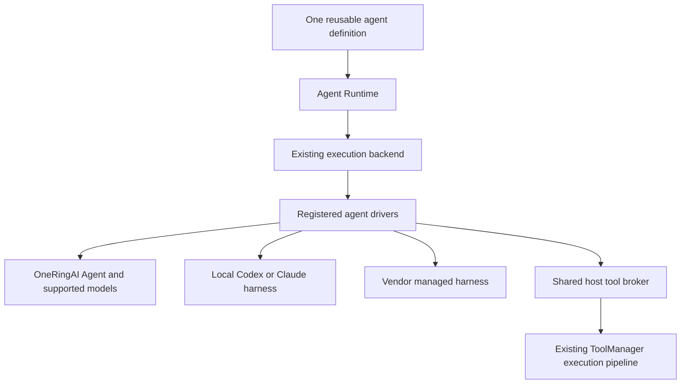

# Agent Harness Expansion Design and Delivery Plan

**Revision 2 — final proposal for approval, 2026-10-28.** Design only; no new runtime implementation or package release. This revision replaces revision 1 after holistic review.

OneRingAI will expose one reusable agent definition and the existing session/run interface across its own harness, local Codex, local Claude Agent SDK, OpenAI Agents API and Claude Managed Agents. Execution is selected when opening a session. New vendors implement the existing driver contract with optional capabilities.

The implementation extends [Agent Runtime](AGENT_RUNTIME.md). Existing `Agent.create()`, runtime `.agent(spec)`, provider integrations, plugin contracts and saved native Agent sessions keep their current behavior. No breaking change, unrelated architecture stage, release or consumer upgrade is included.

## 1. Scope and completion criteria

| Execution option | Current implementation | Delivery in this plan |
| --- | --- | --- |
| OneRingAI harness with supported model providers | Native `Agent` and text providers | Common-definition materialization; existing provider/model coverage retained. |
| Provider-hosted tools inside model calls | Provider-specific integrations | Existing semantics retained; no new harness implied. |
| Local Codex SDK | Runtime preview | Common definitions and selected host tools through a session-scoped MCP bridge. |
| Local Claude Agent SDK | Design only | Optional local driver, host tools, continuation, activity and supported controls. |
| OpenAI Agents API | No driver | Managed sessions, host functions, recovery, cancellation and resource cleanup. |
| Claude Managed Agents | No driver | Managed agent/session resources, custom tools, recovery and correct stop semantics. |

The work is complete when the same common definition and application-tool fixture runs through every delivered binding advertising that profile; the three missing drivers pass their declared conformance suites; desktop restart recovers supported managed sessions without resubmitting work; and compatibility/documentation gates pass.

Choosing another harness means opening a new session with another binding. Restoring a session retains its driver, native state and authorized resource identity. Transferring opaque history across harnesses and automatically falling back after an uncertain execution are outside scope. Identical interfaces do not imply identical model behavior or native features.

## 2. Architecture and ownership



The backend places adapter code. A managed driver can run in `LocalExecutionBackend` while the vendor runs the harness remotely. No new server, worker fleet or sandbox scheduler is required.

| Concern | Authoritative owner |
| --- | --- |
| Definition and selected application tools | Host-created common definition. |
| Harness, model and provider credential | Host-selected execution binding and named `Connector`. |
| Loop, native context and compaction | Selected harness. |
| Host tool identity, accounts and permissions | Authenticated host scope and existing execution pipeline. |
| Native tools and environment restrictions | Driver's verified mapping to vendor enforcement. |
| Runtime IDs, observation and recovery records | Agent Runtime and its scoped storage. |
| Business completion | Host logic; a completed turn does not prove a remote action completed. |

For native OneRingAI execution, `agent.tools === agent.context.tools` remains true. External harnesses retain their own native tool system and context. The host broker provides access to selected application functions without introducing another model loop.

OneRingAI plugins, helper models, compaction strategies and serialized context are not transplanted into vendor harnesses. Memory/evidence/task-state access can be exposed through explicit host tools or deliberately supplied initial content. Native vendor memory is not OneRingAI durable evidence or confirmed host task state.

## 3. Public API

### 3.1 Create once and select execution at session opening

Add `AgentRuntime.createAgent(definition)` beside `.agent(spec)`:

```typescript
// PROPOSED API; not implemented yet.
const agent = runtime.createAgent({
  id: 'research-assistant',
  instructions: 'Compare the proposals using the records you retrieve. Cite sources.',
  tools: ['search_records', 'read_record'],
  requiredCapabilities: [{ id: 'session.continue' }],
});

const session = await agent.openSession({
  execution: deployment.execution,
  environment: deployment.environment,
  policy: deployment.policy,
  context: authenticatedContext,
  observation: { mode: 'live', detail: 'activity' },
});

try {
  const run = await session.run('Compare the approved proposals.', {
    requestId: hostGeneratedRequestId,
  });
  for await (const event of run.events()) renderActivity(event);
  renderAnswer((await run.result).outputText);
} finally {
  await session.destroy();
}
```

The host selects deployment policy and environment appropriate to the harness. Local SDKs can require an explicit directory; managed execution requires configured durable recovery storage. These choices leave the definition and task/UI code reusable.

```typescript
interface RuntimeAgentDefinition {
  id: string;
  revision?: string;
  name?: string;
  instructions: string;
  tools?: readonly string[]; // Exact application tool names, resolved by the host.
  requiredCapabilities?: readonly AgentCapabilityRequirement[];
  metadata?: JsonObject;
}

interface RuntimeExecutionBinding {
  driver: string;
  connector: string;
  model: string;
  reasoning?: RuntimeReasoningConfig;
  driverConfig?: JsonObject;
}

interface RuntimeSessionOptions extends OpenAgentSessionOptions {
  execution: RuntimeExecutionBinding;
  environment?: RuntimeEnvironmentRequest;
}

interface RuntimeDefinitionAgent {
  readonly definition: Readonly<RuntimeAgentDefinition>;
  inspect(options: RuntimeSessionOptions): Promise<RuntimeInspection>;
  openSession(options: RuntimeSessionOptions): Promise<RuntimeSession>;
}
```

`tools` implicitly requires `tools.host`; common definitions require `agent.definition`. Requirements are checked automatically, so callers cannot accidentally request tools and receive a tool-free session. Tool names are not an authorization grant. No parallel tool catalog, aliases or binding-name registry is introduced.

Definitions and bindings are detached, JSON-validated and frozen. The runtime computes an execution-content digest; changing a revision label does not hide changed instructions or tools. Tool implementation/schema fingerprints are captured from the host's resolved tools when opening a session. Compatibility fingerprints are not authorization.

Each common field has one owner. `driverConfig` is a validated vendor escape hatch, not another place for instructions, tool selection, connector/model, credentials, environment identity/placement or tenant authority. Native environment settings such as supported resource sizes can live there without overriding the selected environment. There is no separate public profile registry. Hosts can compose their own deployment configurations; driver constructor callbacks supply scoped native dependencies when necessary.

### 3.2 Execution bindings and model validation

| Driver ID | Harness |
| --- | --- |
| `oneringai.agent` | Native OneRingAI, with any supported/authorized model provider. |
| `openai.codex.sdk` | Existing local Codex SDK. |
| `anthropic.agent.sdk` | New local Claude Agent SDK. |
| `openai.agents.api` | New OpenAI managed harness. |
| `anthropic.managed.api` | New Claude managed harness. |

Driver IDs remain open-ended strings. The connector declares its vendor. The model registry describes the model; the driver separately checks whether its endpoint/harness accepts that model and the requested reasoning controls. Model names and effort values are never translated silently. Host-declared controls for a new/custom model follow existing explicit extension patterns.

OneRingAI's native-only settings come from a host callback on `OneRingAIDriver`, using existing `AgentConfig`/plugin facilities. The callback cannot replace definition-owned instructions/tools, execution-owned model/connector or trusted identity. Existing stored-definition, binding and factory modes remain unchanged through `.agent(spec)`; definition mode rejects a conflicting legacy `source`.

The definition's tool list governs application tools. Native built-ins and OneRingAI plugin-owned tools are separately reported additions, governed by the same host-approved native configuration and policy. Existing OneRingAI plugin defaults are not silently rewritten. Open validates the materialized native/plugin tool set before the first model request; an undeclared or unauthorized addition rejects rather than expanding access.

### 3.3 One inspection path

`RuntimeInspection` extends `ResolvedAgentCapabilities` with definition/configuration digests, selected tool/schema mappings, enabled native tools, environment placement and policy enforcement. It also reports whether recovery is process-only or durable, supported observation/replay, credential entitlement knowledge, usage visibility and missing prerequisites.

The same internal inspection is used by `inspect()` and `openSession()`. There is no separate public `preflight()` or prepared-session protocol. Inspection does not create native resources, launch the harness, acquire mutation ownership or retain tool-manager leases. Host descriptors and optional bounded read-only probes are sufficient; unknown account access is reported honestly and may still fail at open.

Open reauthorizes and acquires scoped resources. Unsupported required capabilities, untranslatable tools and unenforceable requested policy reject before native execution. Unknown security enforcement cannot satisfy a required restriction. A prior inspection result is not a permission token.

### 3.4 Minimal session additions

```typescript
interface RuntimeSession extends AgentSession {
  run(input: AgentRunInput, options?: RuntimeRunOptions): Promise<AgentRun>;
  reference(): RuntimeSessionReference;
  inspectState(): Promise<RuntimeSessionSnapshot>;
  getRun(runId: string): Promise<AgentRun>;
  detach(): Promise<void>;
}

interface RuntimeRunOptions extends AgentRunOptions {
  requestId?: string;
}

interface RuntimeSessionReference {
  version: 1;
  id: string; // Scoped runtime record key; no secret or embedded authority.
}
```

Add `runtime.resumeSession(reference, { context, observation? })` and `runtime.deleteSession(reference, { context })`. Resume restores the recorded binding and currently authorized resources; it cannot select another vendor. `getRun()` attaches to an existing run and sends no input. A reference to process-only state is valid only in that process; inspection makes this limitation visible.

`requestId` identifies an input command within a session. Exact repeats resolve to the same admitted run. A conflicting input/options fingerprint rejects. An unresolved native submission produces a typed recovery error, not a different return type or a second task. Repeated text with a fresh key is a new task. Signals and observer choices are not part of the command fingerprint; another caller's cancellation cannot cancel an existing run merely by repeating its key.

Preserve existing public run/result/event/status unions. `RuntimeSessionSnapshot` separately reports connection (`attached`, `reconnecting`), activity (`ready`, `running`, `waiting`, `unknown`, `terminal`), wait reason, active run ID and unresolved effects. A vendor's resumable budget pause remains an active waiting run; it does not produce `run.finished` or permit a second mutating task. Initial delivery does not expose budget increases/resumption commands.

Terminal mapping retains the existing meanings: verified natural termination is `completed`, native execution error is `failed`, acknowledged requested stop is `cancelled`, and a verified terminal limit/partial stop can be `incomplete`. The exact native finish reason is retained. A refusal or completed turn does not assert business acceptance. Merely waiting, disconnecting or exhausting an observation deadline is not any of these terminal facts.

## 4. Extend the existing driver contract

Use the existing `AgentDriver.inspect/openSession`, `DriverSession`, `DriverRun`, driver registry and backend. Remove the revision 1 configured-driver protocol, backend facet, parallel registration path and new session kernel.

Make narrowly optional additions:

- `RuntimeAgentSpec.definition?: RuntimeAgentDefinition` for the new definition mode. Legacy `instructions`/native `source` and `definition` cannot compete; the new facade emits the definition only, with the required legacy spec ID matching its ID.
- Optional resolved environment and host services on driver inspection/open requests; `workspace` and `ResolvedWorkspace` retain their current types.
- Optional `AgentDriver.restoreSession()` returning a normal `DriverSession` plus an optional reattached active `DriverRun`.
- Optional driver-session checkpoint, state-inspection and detach operations where supported.
- Optional backend resume/delete operations used by the new runtime methods; an older backend rejects those new operations explicitly while its legacy methods remain unchanged.

A restore request carries persisted native state and host services, not another public definition catalog. Driver checkpoints are internal, versioned data; no new mandatory method or protocol version is imposed on existing extensions. Capabilities fail closed when an optional operation is absent.

The runtime compiles a common definition and binding into the normal spec and uses the same backend path. The library backend automatically gates definition/environment features and forwards host services. Custom backends need to preserve/implement those optional features before advertising them; their existing legacy path remains supported. A newer facade must not claim a feature merely because an older custom backend accepts extra JSON fields.

Internally reuse existing event pumping, structured-output validation, workspace ownership and error classes where appropriate. Extend these pieces under legacy characterization tests; do not copy their logic into a second runtime. New typed errors cover uncertain submission/execution, detached observation, changed recovery configuration and storage repair.

Keep vendor SDKs optional and dynamically loaded. Preserve `agent-runtime/codex`; add documented `agent-runtime/claude`, `agent-runtime/openai-managed` and `agent-runtime/claude-managed` subpaths. Prefer the installed official API clients for managed endpoints, updating their minimum version only when necessary and tested. No second handwritten HTTP SDK is planned. Base imports must not load vendor CLI packages or start processes.

## 5. One host tool broker

### 5.1 Resolution and execution

Add one backend host-tool resolver receiving exact requested names and trusted session context. It returns the selected existing `ToolFunction`s, their fingerprints and native host dependencies, with clear ownership. A map is enough for a simple application; a multi-user host may resolve connector/account-specific functions. Nothing new is persisted as an authoritative tool catalog.

Use `ToolManager.executeWithOutcome()` and its existing permission, identity, timeout, cancellation, connector and evidence middleware. Native OneRingAI materialization installs the selected functions on its existing shared manager. External harness sessions use one scoped manager through the broker. Do not create a dummy model-capable Agent to run tools.

ToolManager-level guarantees and Agent-level lifecycle hooks are different. Standalone external sessions preserve manager pipeline semantics; they do not automatically execute native Agent `before:execution`/`after:execution` hooks or plugin context assembly. A host deliberately using an existing Agent as its tool owner may reuse `beginExternalExecution/executeExternalToolCall/completeExternalExecution`, retaining that owner's hooks and limits. No claim of full Agent lifecycle parity is made for a bare manager.

The broker preserves scope, captured account/identity metadata, call/run IDs, raw returns, operational outcomes, optional evidence and late results. A business `{ success: false }` remains business data unless execution actually failed. Host outcomes determine transport failure flags; driver code must not classify failures by inspecting arbitrary application fields.

Resolve/check tool names and schemas before opening. Reject reserved-name collisions, lossy schema conversion and incompatible result content. Native transport prefixes are mapped internally. Start with eager selected definitions and serialized blocking host calls in the new common-definition path; selected background/nonblocking tools reject in this initial profile rather than silently changing their execution metadata. Existing legacy execution defaults remain unchanged. Avoid adding dynamic catalogs or parallel-call configuration in the first delivery. Native requests can arrive concurrently and queue under the same scope, retaining separate invocation identities.

Durable restoration requires stable implementation fingerprints as well as schema equality. Reuse generated fingerprints where available; a custom host tool supplies its own explicit implementation revision. Do not guess executable compatibility from `Function.toString()` or a matching name/schema. Process-only sessions can retain their actual host registration identity instead.

### 5.2 Transport adapters

| Harness | Route to the same host broker |
| --- | --- |
| OneRingAI | Its native shared ToolManager. |
| Local Codex | Authenticated session-scoped loopback Streamable HTTP MCP server. |
| Local Claude | Official SDK in-process MCP server. |
| OpenAI managed | Pending function action and matching tool-result event. |
| Claude managed | Custom-tool event and matching result event. |

The installed Codex SDK exposes structured CLI configuration overrides, and official Codex documentation supports Streamable HTTP MCP and bearer-token configuration. That provides a concrete implementation route; an end-to-end bridge is still an H1 delivery gate. Inject only this internal server into the driver's isolated configuration, mark it required and restrict enabled tools. No App Server substitution is planned. [Codex MCP configuration](https://learn.chatgpt.com/docs/extend/mcp).

The loopback server binds a session credential to exact scope, selected tools and active run; it rejects unauthenticated requests, wrong origin/host headers and expired sessions. It is trusted control traffic, not general sandbox network access. Keep the bearer token out of model-visible data and inherited shell environments. MCP request IDs are transport IDs; the bridge must allocate and persist invocation identity before dispatch and cannot deduplicate writes by equal arguments. Where a native retry cannot be correlated reliably, do not advertise crash-resumable local host calls.

If the pinned SDK cannot satisfy bridge safety/functional tests, stop that affected support claim and present the specific limitation and smallest alternate transport for approval. Do not mark host-tool interchangeability complete with a deferred exception.

Direct vendor-native MCP and shell tools are separate from brokered host functions. Their calls do not acquire OneRingAI outcome/evidence guarantees. Native features are disabled unless explicitly configured and enforceable; unrestricted native Bash/network would otherwise bypass a host-tool allowlist.

### 5.3 Recoverable host calls

Managed host calls use an acknowledged ledger keyed by trusted session, native turn/thread and call ID. The canonical name/arguments fingerprint detects conflicting reuse.

```text
observed -> admitted -> executing -> outcome stored -> delivery pending -> acknowledged
```

Persist admission before side effects and the actual result/outcome before sending it back. Replayed pending calls use the saved result. Unknown result-delivery acknowledgment is reconciled against native pending actions before redelivery. Never rerun the function to recreate its result.

A crash after a side effect and before outcome persistence remains uncertain. `executing` after restart is not failure or permission to retry. Use downstream idempotency only when the tool explicitly supports it; otherwise require host reconciliation. Late results retain original IDs. Cancellation, timeout, failed evidence storage and failed projection do not justify repeating an action.

The execution ledger is separate from optional evidence. UI events are redacted; exact recovery payloads may be private and are protected by scoped storage/host encryption policy. Persist the vendor-visible projection once and redeliver that payload. Storage exhaustion blocks new admissions and preserves unresolved records. Ordinary in-process calls may use volatile records; managed execution requires durable records.

## 6. Environments and artifacts

Keep current workspace types intact. Add a separate optional `RuntimeEnvironmentRequest`:

```typescript
type RuntimeEnvironmentRequest =
  | { type: 'none' }
  | { type: 'local-directory'; path: string }
  | { type: 'provider-managed'; reference?: string };
```

A provider reference is an authorized native environment/template ID, not an arbitrary endpoint or credential. When omitted, the driver creates an owned environment using its validated configuration. Resolved environments identify placement, native resource identity, ownership and verified policy enforcement. Self-hosted provisioning is deferred rather than adding an unused provider framework now.

Supplying both `workspace` and `environment` rejects. No environment request means none requested; a local SDK requiring a directory rejects instead of inheriting cwd. Existing local-directory requests still use canonical path/symlink validation and exclusive mutation ownership. Managed workspaces never masquerade as local paths.

Use existing `AgentArtifact` variants. A native file reference is not a downloaded local file. Initially list/reference generated artifacts. Add explicit scoped upload/download through the runtime before claiming desktop file-input support; reusing `workspace-file` to upload silently is prohibited. Transfers enforce byte/MIME bounds, current connector/scope, expiry and destination traversal/symlink checks. Rich or unsupported inputs reject before task submission. Do not forward credentials to a returned arbitrary artifact URL.

Sessions, reusable agent resources, environments and uploaded files have separate ownership/cleanup records. Borrowed resources are never mutated/deleted by session disposal. Initial managed implementations create per-session owned resources where required; remote agent deduplication/caching is deferred.

## 7. Durability and lifecycle

### 7.1 Storage scope

Introduce one `IRuntimeSessionStorage` through an optional scoped `StorageRegistry` factory, with explicit backend injection following existing storage conventions. Reuse path/serialization utilities, but do not claim `FileContextStorage` or its history journal already supplies acknowledged cross-process command transactions.

Provide an in-memory implementation for tests/process-only execution and a single-host file implementation for desktop recovery. The minimal interface is scoped load/create/update with expected revision plus exclusive session ownership; control-state updates include related command/outbox records atomically. Do not build a distributed lease service or general transactional database. The file adapter must use a tested lock and acknowledged crash-safe commit, document supported filesystems/platforms and reject a second writer. It must not expire a lock and replay work simply because a timer elapsed.

Persist definition/binding/tool fingerprints, authorized resource references, native IDs/checkpoints, command intents/acknowledgments, pending calls/interactions, outcomes/outbox, terminal results, usage high-water marks and owned cleanup. Store no provider credentials. A host that retains definitions by reference must make that immutable revision available again; otherwise persist the detached definition in protected storage.

Managed drivers require a durable adapter before creating resources. Recovery of native OneRingAI or local SDK state is advertised only when the complete native checkpoint and dependencies are restorable. A durable runtime log alone does not prove a local process's history survived. Same-host file storage is not tenant isolation or multi-host scheduling.

### 7.2 Durable control and bounded activity

Control records must be acknowledged before dispatching side effects or reporting terminal completion. Token/command-output deltas use the existing bounded event hub; do not fsync every token or require indefinite activity replay. Control records and final messages/results survive restart. Historical activity is replayable only while retained, or if an optional host journal explicitly retains it.

Keep public session/run IDs stable on restore. Allocate event sequences from durably reserved ranges so previously emitted numbers cannot be reused after a crash. Skipped/evicted ranges are explicit replay gaps; `afterSequence` never silently claims complete recovery. Where full activity is unavailable, return the existing history-expired behavior and a current-state diagnostic. Native replay deduplication for side effects is controlled by the call/command ledger, independent of whether UI activity was retained.

### 7.3 Resume and retry

Resume reauthorizes the runtime reference, acquires single-writer ownership, reconstructs the exact definition/binding and tool scope, reads native status/pending actions, and reconciles input/tool-result commands before pumping events. It never sends the original user task again.

Definition, schema, implementation, workspace or relevant policy changes require an explicit compatible migration or a new session. Do not turn a changed file path/configuration into a supposed continuation. Credential refresh/rotation is permitted for the same authorized account/project; account substitution is not. A stricter policy must actually constrain still-running native work or leave the session quarantined.

Use documented native idempotency for creation/input/result commands where available. Lost acknowledgment after dispatch otherwise remains uncertain until native state/correlation can establish the outcome. Disable SDK automatic mutation retries where idempotency is unproven. Bounded reads/replay can retry with backoff, jitter and vendor retry hints. Reconcile provider-managed retries rather than starting another run.

An idempotency key/result record is retained for the recoverable session lifetime, including after the activity buffer is evicted. Cleanup leaves tombstones where needed to reject duplicate admitted inputs/calls. Explicit retention expiry ends the guarantee and makes the reference unusable; it does not silently create new work.

### 7.4 Cancellation, detach and deletion

| Operation | Meaning |
| --- | --- |
| `run.cancel()` / `cancelActiveRun()` | Request cancellation; confirm actual native and owned host-call settlement. |
| `session.destroy()` | Cancel/drain attached owned work and dispose the handle. No implicit deletion of vendor history. |
| `session.detach()` | Persist and dispose observation while work may continue. Requires restorable durable state and a permitted callback owner. |
| `runtime.deleteSession()` | Explicitly stop/reconcile owned work and delete owned native/runtime resources under current authorization. |

There is no additional `terminate()` or `shutdown()` API. Desktop code can cancel/inspect/destroy tracked sessions and handle rejected cleanup promises; existing runtime `destroy()` remains its documented best-effort cleanup and is not a remote-termination guarantee.

`AbortSignal` requests native cancellation, not just HTTP-stream closure. Connection loss is neither failure nor successful cancellation. While the run is running, budget-paused or awaiting required actions, its result promise remains pending. If the observer detaches or a configured observation/cleanup deadline expires, the public observer promise rejects with a typed reference-bearing error; no fabricated terminal result/event is emitted. The underlying `DriverRun.result` retains its existing terminal-settlement contract; observer rejection is handled by the runtime wrapper and persisted recovery state. Any still-running native work is quarantined from new admissions.

Destroying a new-session handle reports uncertain cleanup by rejection and retains its recovery record. Stop observation after persisting that state; do not release a reusable environment or discard an executing tool result prematurely. Existing legacy handle semantics are unchanged. Already-dispatched external writes can finish after cancellation; track their late outcome separately from the cancelled native turn.

Detach rejects unresolved local result promises and invalidates that handle; resume provides new observer handles for the same IDs. It does not transfer execution authority. If a desktop-only callback broker is required, detach may let calls wait only within the declared policy/time bounds; it cannot promise uninterrupted cloud execution after the app closes. Closing the app never defaults pending approval to allow.

## 8. Observations, interactions and policies

The backend owns the event pump; UI subscription/filtering never controls execution. Preserve existing live/final-only, activity/reasoning and observe-only/steerable axes. Normalize only native activity actually exposed, including reasoning summaries where available. Redact secrets before public journaling/events/errors. Bound unknown/native payloads and fail on unsupported protocol versions instead of guessing. Interruption followed by another input is a new run; it is not advertised as in-place steering unless the driver verifies that semantic.

Use existing `diagnostic` and `interaction.*` events with documented data fields, not new literals in legacy unions. Reconstruct pending interactions from durable/native state even when their original activity event is absent. Interaction identity includes native session/turn/call, argument digest, kind, allowed responses and expiry. Exact duplicate decisions are idempotent; conflicting, stale, expired and cross-session responses reject. User-supplied strings are not approvals or fabricated tool results.

Host-tool approval is enforced by the host permission pipeline; native-tool approval is enforced through the driver's verified callback/protocol. Interactive mode is advertised only when the complete requested path works. Do not implement a weaker session-wide grant when `accept-for-session` is unsupported. Initial drivers can ship autonomous execution first, with explicit rejection of unsupported interactions.

Reuse `AgentExecutionPolicy`. Do not add the revision 1 generic constraint/region/cost-budget DSL. Inspect the actual enforcement for host calls, native shell/filesystem, native MCP, web tools and sandbox egress independently. Unknown/unenforceable restrictions fail; a prompt is not enforcement. Provider control traffic is distinct from shell network permission.

Native/project/home configuration, plugins, skills, executables and MCP endpoints are trusted code/resources. New local drivers disable ambient configuration by default and construct a minimal child environment. Explicit host configuration is captured in the effective digest. Default native subagents, workflows, schedules and vendor memory off; if they cannot be disabled/verified, the relevant guarantee is unsupported. A host decides from inspection whether data transfer/retention meets its deployment requirements; no generic compliance engine is added.

## 9. Driver-specific implementation

| Driver | Required implementation and boundary |
| --- | --- |
| OneRingAI | New definition mode materializes native Agent using existing config/plugins/manager. Existing stored/binding/factory modes unchanged. |
| Codex SDK | Preserve API-key connector, isolation, model checks and existing events; add required scoped MCP configuration. SDK restore/approvals/steering are advertised only when verified. |
| Claude Agent SDK | Official optional SDK, isolated query/process and native state location, in-process MCP broker, output/event conversion, cancellation and tested continuation. |
| OpenAI managed | Inline common agent configuration where supported, owned session/environment, pending-function adapter, durable command/result recovery and native stop reconciliation. |
| Claude managed | Immutable per-session owned agent resource where required, session/environment creation, custom-tool adapter, exact idle/interrupt interpretation and owned cleanup. |

OpenAI's managed API runs its harness while application functions return results separately. Pending actions, rather than historical function items, determine what needs answering. [Managed API](https://developers.openai.com/api/docs/guides/agents-api/overview), [function lifecycle](https://developers.openai.com/api/docs/guides/agents-api/tools/functions).

Claude Managed Agents separates agent/environment/session resources; local Claude tools can use its SDK's in-process MCP mechanism. [Managed architecture](https://platform.claude.com/docs/en/managed-agents/overview), [local tools](https://code.claude.com/docs/en/agent-sdk/custom-tools).

Claude idle may mean end-turn, required action or budget pause. An interrupt can share the natural end-turn reason; queued acknowledgment is not stop confirmation. Track cancellation intent and native processing, answer only still-pending calls, and do not complete while owned work remains active. Disable native workflows initially. [Claude event semantics](https://platform.claude.com/docs/en/managed-agents/events-and-streaming).

Use native structured output plus existing local schema validation. Do not silently run a repair agent, repeat the task or mutate history after failure. Honor per-run model/reasoning overrides only when their exact turn scope is supported; otherwise reject. Generated files, partial output and actual usage remain available on failed/incomplete execution where safely recoverable.

## 10. Authentication and accounting

Initial drivers use documented API-key access through named Connectors. Reuse connector auth/refresh and scoped registries; there is no runtime token store. Account/project, endpoint origin and native-resource authorization are checked before token forwarding. Credentials, executable handles and host authority never enter definitions, renderer IPC or serialized session records.

Subscription login is a separately selected extension, contingent on provider approval and entitlement to the exact endpoint. Neither local CLI login nor identity OAuth establishes managed API billing access. Use supported flows and client registration; do not copy consumer auth files or impersonate another client. Native billing plans/credits remain vendor-owned. [OpenAI sign-in boundary](https://developers.openai.com/siwc/quickstart), [Claude SDK boundary](https://code.claude.com/docs/en/agent-sdk/overview).

Preserve existing `RuntimeUsage`. Cumulative provider counters are deduplicated by source/session and high-water mark. Report a per-run value only if the adapter can attribute it; otherwise keep it unknown and expose session totals in inspection/state metadata. Cache/reasoning counts follow native definitions. Never add child totals to a session aggregate that already includes them.

`ModelTask` controls only calls whose dispatch OneRingAI owns. External harness usage can be observed without pretending OneRingAI admitted every hidden call. No new universal budget ledger is included. Verified native budget settings remain in validated driver configuration with precise scope/overshoot semantics. Existing wall-time policy triggers cancellation; it cannot promise immediate remote stop. Do not advertise a hard token/currency ceiling or complete invoice from partial usage events.

## 11. Incremental implementation sequence

The stage IDs below replace revision 1's H0–H8 table. Approving this revision can authorize H0–H6 sequentially; finish each stage and its validation before the next. No optional extension is implied.

| Stage | Delivery | Required exit evidence |
| --- | --- | --- |
| H0 | Freeze final signatures, characterize legacy runtime, confirm pinned SDK/managed-wire mappings and compile proposed contracts. | Old public/custom-driver/backend fixtures pass; no unresolved ownership or public breaking change. Codex MCP route/configuration is concretely exercised offline. |
| H1 | Common-definition facade, optional driver fields, OneRingAI materialization and shared broker; Codex MCP bridge. | One definition/tool fixture works through native scripted providers and local harness transport. Scope/outcomes/schema/permission tests pass. Codex bridge is delivered, not deferred behind a parity claim. |
| H2 | Local Claude Agent SDK. | Mock SDK and opt-in live autonomous tool loops, continuation, cancellation and owned cleanup; advertised interaction features tested. |
| H3 | Scoped durable runtime storage, command/outcome outbox, same-driver resume, detach and deletion. | Crash-boundary/input deduplication/replayed tool-call tests, second-writer rejection, file corruption/quota handling and actual single-host restart recovery. Local native restore remains separately capability-gated. |
| H4 | OpenAI managed API driver and provider-managed environment/native artifact references. | Accepted-input recovery, pending-action broker delivery, loss/reconnect, stop uncertainty and owned-resource cleanup; official-wire fixtures plus opt-in live smoke. |
| H5 | Claude managed API driver. | Agent/session resource ownership, custom-tool recovery, natural stop versus interrupt/required action/budget, no shared-config mutation; fixtures plus opt-in live smoke. |
| H6 | Explicit file transfer, cross-driver conformance, AMOS runtime selection and documented desktop integration. | Same definition/UI on advertised bindings; app restart and shutdown walkthrough; bounded authorized file transfer and full compatibility/docs gates. |

Dependencies are H0 → H1 → H2 → H3 → H4 → H5 → H6 for the approved delivery sequence. H3 does not depend on implementing a remote backend; H4/H5 cannot ship durable claims before H3. H6 documents desktop integration and provides AMOS demonstrations; it does not authorize modifying an unrelated desktop application repository.

Each stage ships deterministic offline examples, setup/expected behavior/cleanup, focused regression/failure tests and public documentation. Live examples are explicitly enabled and billable. Native-only AMOS commands remain capability-gated; external sessions cannot be treated as native `Agent.context` instances.

The full required profile is reusable instructions plus selected application tools, session continuation, live activity, cancellation and honest recovery semantics. Rich approvals, native command/file events, structured output and local cross-process restore remain individually negotiated. A missing required feature is a typed preflight rejection, not a skipped success. If a required vendor/account/platform guarantee is unavailable, record the exact blocker and revise the affected support claim before completion.

Deferred extensions: approved subscription authentication, Codex App Server, OpenAI Agents SDK runner as its own driver, self-hosted executors, native subagents/workflows/memory, lazy discovery, parallel host tools, cross-harness history transfer, distributed ownership/server backend and A2A. These are independent future slices under the same existing extension points; no scaffolding beyond required optional fields is built now.

## 12. Validation and documentation gates

| Area | Minimum meaningful coverage |
| --- | --- |
| Compatibility | Legacy runtime/Agent signatures, custom drivers/backends, ESM/CJS subpaths, optional SDK absent, enum exhaustiveness and native saved sessions. |
| Definition/model | Frozen inputs, conflicting native overrides, wrong connector vendor/model, unsupported reasoning, changed definitions/tool implementations on restore. |
| Host tools | Exact allowlist/account identity, schema/name rejection, permission denial, operational versus business failure, hooks boundary, evidence failure and late outcome correlation. |
| Recovery | Crash before/after create/input acknowledgment; after write/before saved outcome; after saved result/before delivery acknowledgment; duplicate/conflicting commands and calls. |
| Lifecycle | Concurrent run/second writer, abort at each phase, unknown stop, paused native work, detach without callback owner, active disposal and orphan cleanup. |
| Events/interactions | Unconsumed/filtered streams, bounded buffers, replay gaps, stable IDs/sequences, stale approval, changed arguments, expiry and native protocol evolution. |
| Data/resources | Ambient config injection, split-secret redaction, cross-scope references, credential rotation, artifact expiry/path escape and borrowed-resource preservation. |
| Accounting | Partial/cumulative usage, replay, session-versus-run attribution, missing costs and refusal of unsupported hard guarantees. |

Run focused relevant tests while iterating. At each public-contract stage run build, typecheck, lint, unit tests, examples checks, the built-package `test:agentic:compat` and offline agentic baseline. Regenerate generated API documentation rather than editing it manually. Avoid retesting unrelated live providers by default.

Live suites use disposable owned resources and harmless deterministic host tools. Include forced disconnect/reconnect and cancellation/cleanup for each managed vendor. Missing credentials/entitlements/platform support are unavailable validation, not passes. No production mutations or secret printing; retain cleanup references after test failure.

Update the runtime design/support matrix, README, User Guide, API reference, examples index, AMOS docs, CHANGELOG and Version 2 availability/adoption/handoff ledger in the delivering stage. Record actual branch availability, versions/platforms/auth modes, limitations and checks separately from release status. Add stage records without renumbering the existing architecture roadmap or claiming unrelated stages complete. Consumer collection/static semantics and portable wire versions remain unchanged.

Any discovered breaking API or behavioral change stops only that affected work for a specific explanation, alternatives, migration and separate approval. Approval of this plan does not waive the standing compatibility rule or authorize Stage 16B, a release, consumer upgrades or unrelated repository changes.

## 13. Holistic review resolutions

| Revision 1 issue | Final resolution |
| --- | --- |
| Second configured-driver protocol and backend facet duplicated current architecture. | Existing driver/backend/session contracts with optional fields and restore hooks. |
| `inspect` and `preflight` overlapped; prepared handles could acquire resources during inspection. | One side-effect-free inspection implementation, rechecked on open. |
| Tool names, binding names, profile registry and broad resource resolver added indirection. | Exact tool-name list, one trusted tool resolver, existing driver constructor configuration. |
| Bare ToolManager was claimed to preserve all native Agent lifecycle hooks. | Guarantee manager semantics; explicit Agent owner retains its own execution hooks. |
| Durable mode default conflicted with managed-driver requirements. | Storage configuration determines durability; managed open requires durable storage. |
| `requestId` could return a submission record despite a promised `AgentRun`. | Same run on accepted duplicate; typed recovery error for unknown admission. |
| Activity replay required excessive durable machinery and per-token work. | Acknowledged control records, bounded activity, reserved sequences and explicit gaps. |
| New terminate/shutdown/delete methods overlapped or depended on live handles. | Existing cancel/destroy, one detach operation and reference-based runtime deletion. |
| Codex tool interchangeability was left as an optional future transport. | Concrete scoped MCP route and mandatory H1 bridge gate; no silent App Server fallback. |
| Native resource caching, generic governance/budget DSL and distributed leases enlarged scope. | Per-session owned resources; existing policy/accounting; single-host storage ownership. |
| Environment/file-transfer and desktop scope were spread across phases. | Native artifacts in driver stages; explicit transfer/desktop integration in H6; no unrelated app edits. |
| Vendor pauses/disconnects could be confused with terminal completion. | Separate operational state; result remains pending until verified terminal or observer rejection. |

Review evidence: current runtime, Agent external-execution path, ToolManager pipeline, storage implementations and installed Codex SDK declarations were inspected. Current official Codex MCP, managed-function and Claude session/tool documentation was checked. The representative proposal fixture checks additive type compatibility against the built public package. The SDK probe invokes a temporary fake executable to check nested MCP configuration serialization and isolated fixture environment forwarding; it does not start Codex, connect MCP or make API calls.

- [Proposed contract fixture](../evaluations/agent-harness-design/contracts.ts)
- [Fixture configuration](../evaluations/agent-harness-design/tsconfig.json)
- [Offline SDK serialization probe](../evaluations/agent-harness-design/codex-config-probe.mjs)

Design checks passed on 2026-10-28:

```bash
node node_modules/typescript/bin/tsc -p docs/evaluations/agent-harness-design/tsconfig.json
node docs/evaluations/agent-harness-design/codex-config-probe.mjs
```

Local document links, fenced blocks and whitespace were checked. Runtime, live vendor and operating-system enforcement tests remain stage delivery requirements; no implementation conformance is claimed by these design checks.

Approval requested: **revision 2 and sequential H0–H6 implementation**, retaining all support gates, examples/tests/documentation requirements and the separate breaking-change rule. Runtime implementation has not started.
